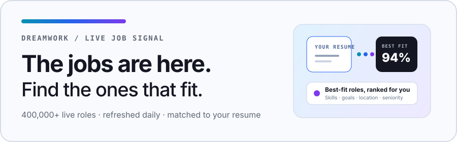

<a href="https://www.dreamworkhq.com/?utm_source=github&utm_medium=readme_cta&utm_campaign=gh-cybersecurity-jobs">
  <picture>
    <source media="(prefers-color-scheme: dark)" srcset="./static/img/banner-dark.svg">
    <source media="(prefers-color-scheme: light)" srcset="./static/img/banner-light.svg">
    
  </picture>
</a>

<h1 align="center">Cybersecurity Jobs</h1>

Security engineering, InfoSec, AppSec, SOC, and GRC roles in the US and worldwide. Every listing is classified by function from the posting itself and rechecked daily.

  
  

  <a href="https://www.dreamworkhq.com/?utm_source=github&utm_medium=readme_cta&utm_campaign=gh-cybersecurity-jobs">
    <picture>
      <source media="(prefers-color-scheme: dark)" srcset="./static/img/btn-matches-dark.svg">
      <source media="(prefers-color-scheme: light)" srcset="./static/img/btn-matches-light.svg">
      
    </picture>
  </a>

  <a href="https://www.dreamworkhq.com/?utm_source=github&utm_medium=link_row&utm_campaign=gh-cybersecurity-jobs">dreamworkhq.com</a>
  ·
  <a href="https://www.dreamworkhq.com/blog?utm_source=github&utm_medium=link_row&utm_campaign=gh-cybersecurity-jobs">Blog</a>
  ·
  <a href="https://www.dreamworkhq.com/research?utm_source=github&utm_medium=link_row&utm_campaign=gh-cybersecurity-jobs">Hiring research</a>
  ·
  <a href="../../issues">Report a listing</a>

Star this repo and new roles land in your GitHub feed every day. Listings come from [Dreamwork](https://www.dreamworkhq.com/?utm_source=github&utm_medium=readme_cta&utm_campaign=gh-cybersecurity-jobs), which crawls 2M+ live jobs directly from company career pages.

Last updated: **2026-11-03**. Showing the **396** most recently indexed roles, curated from **1,000+** open listings on Dreamwork. Salary shows when the posting discloses it. Click a role to see details and apply.

<!-- TABLE_START (auto-generated: do not edit by hand; edits are overwritten daily) -->

| Company | Role | Location | Pay | Added |
| --- | --- | --- | --- | --- |
| **[Nvent](https://www.dreamworkhq.com/c/nvent.com?utm_source=github&utm_campaign=gh-cybersecurity-jobs)** | [Network Security Engineer](https://www.dreamworkhq.com/job/8ca57d42-dd78-4534-a805-91bf334d4d0f?utm_source=github&utm_campaign=gh-cybersecurity-jobs) | Bangalore, IN (Hybrid) |  | 0d |
| **[Nvent](https://www.dreamworkhq.com/c/nvent.com?utm_source=github&utm_campaign=gh-cybersecurity-jobs)** | [Network Security Administrator](https://www.dreamworkhq.com/job/4fc78236-8d3e-4df3-80a2-0f4d1bf5ace4?utm_source=github&utm_campaign=gh-cybersecurity-jobs) | Bangalore, IN (Hybrid) |  | 0d |
| **[Cherry Creek](https://www.dreamworkhq.com/c/cherrycreekschools.org?utm_source=github&utm_campaign=gh-cybersecurity-jobs)** | [Security Specialist - Cherry Creek Innovation Campus](https://www.dreamworkhq.com/job/cd0c6506-24d4-40d1-8a97-076857052dba?utm_source=github&utm_campaign=gh-cybersecurity-jobs) | CO, United States |  | 0d |
| **[Sagecare](https://www.dreamworkhq.com/c/sagecare.ai?utm_source=github&utm_campaign=gh-cybersecurity-jobs)** | [Senior Security Engineer](https://www.dreamworkhq.com/job/f7874fde-e229-4654-b679-2b64b4dfccb3?utm_source=github&utm_campaign=gh-cybersecurity-jobs) | HQ | $145K–$175K | 0d |
| **[Theocc](https://www.dreamworkhq.com/c/theocc.com?utm_source=github&utm_campaign=gh-cybersecurity-jobs)** | [Lead Associate Principal, Cyber Defense](https://www.dreamworkhq.com/job/e24ab312-1b7a-4906-86be-734d0209d2bf?utm_source=github&utm_campaign=gh-cybersecurity-jobs) | Chicago - 125 S Franklin (Hybrid) | $133K–$218K | 0d |
| **[CACI](https://www.dreamworkhq.com/c/caci.com?utm_source=github&utm_campaign=gh-cybersecurity-jobs)** | [SAP Security Administrator](https://www.dreamworkhq.com/job/4f2aee16-2527-41f5-b8a5-b6866e451135?utm_source=github&utm_campaign=gh-cybersecurity-jobs) | Remote (Remote (Any State)) | $90K–$190K | 0d |
| **[Leonardocompany](https://www.dreamworkhq.com/c/leonardocompany-us.com?utm_source=github&utm_campaign=gh-cybersecurity-jobs)** | [Product Security Degree Apprentice](https://www.dreamworkhq.com/job/dd1b4c89-8144-4198-8bbc-004fb4921e93?utm_source=github&utm_campaign=gh-cybersecurity-jobs) | GB - Basildon (Hybrid) |  | 0d |
| **[Leonardocompany](https://www.dreamworkhq.com/c/leonardocompany-us.com?utm_source=github&utm_campaign=gh-cybersecurity-jobs)** | [Product Security Degree Apprentice](https://www.dreamworkhq.com/job/038492ab-57af-4bb6-8d0f-9a86ccd997fe?utm_source=github&utm_campaign=gh-cybersecurity-jobs) | GB - Southampton (Hybrid) |  | 0d |
| **[Cherokee Federal](https://www.dreamworkhq.com/c/cherokeecasino.com?utm_source=github&utm_campaign=gh-cybersecurity-jobs)** | [Mid Cyber Analyst](https://www.dreamworkhq.com/job/aa320fae-3138-4164-8147-4e8d83c54191?utm_source=github&utm_campaign=gh-cybersecurity-jobs) | Washington, DC, United States | $115K–$127K | 0d |
| **[Two Six Technologies](https://www.dreamworkhq.com/c/twosixtech.com?utm_source=github&utm_campaign=gh-cybersecurity-jobs)** | [Security Operations Intern](https://www.dreamworkhq.com/job/f029e3cb-d324-407a-917c-5cfa87c4b8fc?utm_source=github&utm_campaign=gh-cybersecurity-jobs) | Arlington, Virginia | $42K–$83K | 0d |
| **[Leidos](https://www.dreamworkhq.com/c/leidos.com?utm_source=github&utm_campaign=gh-cybersecurity-jobs)** | [Cyber Security Engineer](https://www.dreamworkhq.com/job/512471c2-b1b9-404f-9b6e-fb9ad6ec46aa?utm_source=github&utm_campaign=gh-cybersecurity-jobs) | Farnborough, Hampshire, UK (Hybrid) | $63K–$81K | 0d |
| **[Leidos](https://www.dreamworkhq.com/c/leidos.com?utm_source=github&utm_campaign=gh-cybersecurity-jobs)** | [Sr. Cybersecurity Systems Engineer](https://www.dreamworkhq.com/job/4f5a79a4-f2dc-4230-9e6e-de1da6f4f193?utm_source=github&utm_campaign=gh-cybersecurity-jobs) | Linthicum Heights, MD | $131K–$237K | 0d |
| **[Xact Placements Limited](https://www.dreamworkhq.com/c/xactplacements.com?utm_source=github&utm_campaign=gh-cybersecurity-jobs)** | [Junior Security Engineer (Firewalls)](https://www.dreamworkhq.com/job/4e682ea5-0c59-4f39-9015-6877eb7e7a86?utm_source=github&utm_campaign=gh-cybersecurity-jobs) | Hertfordshire | $37K–$46K | 0d |
| **[Certain Advantage](https://www.dreamworkhq.com/c/certainadvantage.com?utm_source=github&utm_campaign=gh-cybersecurity-jobs)** | [Cyber Security Engineer](https://www.dreamworkhq.com/job/8190ee3d-e6c3-4dc0-8439-5e8a0ddd4d13?utm_source=github&utm_campaign=gh-cybersecurity-jobs) | SG12DA | $253K | 0d |
| **[Akkodis](https://www.dreamworkhq.com/c/akkodis.com?utm_source=github&utm_campaign=gh-cybersecurity-jobs)** | [Cyber Security Engineer](https://www.dreamworkhq.com/job/a8a6b624-141d-4997-b025-ed24cccb81c5?utm_source=github&utm_campaign=gh-cybersecurity-jobs) | Stevenage |  | 0d |
| **[Nscale](https://www.dreamworkhq.com/c/nscale.com?utm_source=github&utm_campaign=gh-cybersecurity-jobs)** | [Senior Staff Machine Identity and PKI Engineer](https://www.dreamworkhq.com/job/244e94be-9f7f-4c36-9fa5-2e6df65987f2?utm_source=github&utm_campaign=gh-cybersecurity-jobs) | AMER | $210K–$270K | 0d |
| **[Nscale](https://www.dreamworkhq.com/c/nscale.com?utm_source=github&utm_campaign=gh-cybersecurity-jobs)** | [Senior Detection & Response Engineer, Cyber Defense](https://www.dreamworkhq.com/job/c60fdcc3-98f7-457a-8b8a-7a4d03372da8?utm_source=github&utm_campaign=gh-cybersecurity-jobs) | UK |  | 0d |
| **[Booz Allen Hamilton](https://www.dreamworkhq.com/c/boozallen.com?utm_source=github&utm_campaign=gh-cybersecurity-jobs)** | [Data Security Engineer, Senior](https://www.dreamworkhq.com/job/299cbcfd-98ef-48a4-8656-7f3ce81bd67f?utm_source=github&utm_campaign=gh-cybersecurity-jobs) | Colorado Springs, CO (Hybrid) | $87K–$198K | 0d |
| **[Booz Allen Hamilton](https://www.dreamworkhq.com/c/boozallen.com?utm_source=github&utm_campaign=gh-cybersecurity-jobs)** | [Data Security Engineer](https://www.dreamworkhq.com/job/f1b89920-7e7f-4ab5-8030-fb54479c18a9?utm_source=github&utm_campaign=gh-cybersecurity-jobs) | Fort Meade, MD (Hybrid) | $99K–$225K | 0d |
| **[Booz Allen Hamilton](https://www.dreamworkhq.com/c/boozallen.com?utm_source=github&utm_campaign=gh-cybersecurity-jobs)** | [Cybersecurity Engineer and Risk Analyst](https://www.dreamworkhq.com/job/aed0c7f3-52b9-469f-9029-03914b77c147?utm_source=github&utm_campaign=gh-cybersecurity-jobs) | San Diego, CA (Hybrid) | $62K–$141K | 0d |
| **[Xplor](https://www.dreamworkhq.com/c/xplortechnologies.com?utm_source=github&utm_campaign=gh-cybersecurity-jobs)** | [Senior Cybersecurity Engineer \| Cyber Threat Intelligence & Response](https://www.dreamworkhq.com/job/ec74821c-18ee-4e53-ba58-418fa12724aa?utm_source=github&utm_campaign=gh-cybersecurity-jobs) | Remote (Auckland, Auckland, New Zealand) |  | 0d |
| **[Lennar Corporation](https://www.dreamworkhq.com/c/lennar.com?utm_source=github&utm_campaign=gh-cybersecurity-jobs)** | [Security Engineer II](https://www.dreamworkhq.com/job/3888dde9-ab67-43b5-9a42-b56a3f05a45c?utm_source=github&utm_campaign=gh-cybersecurity-jobs) | Irving, TX (Job Posting Location) (Hybrid) |  | 0d |
| **[Chevron](https://www.dreamworkhq.com/c/chevron.com?utm_source=github&utm_campaign=gh-cybersecurity-jobs)** | [Senior OT Cybersecurity Engineer](https://www.dreamworkhq.com/job/1b044ccc-4bda-4eb3-90cb-63c9f2035303?utm_source=github&utm_campaign=gh-cybersecurity-jobs) | Bengaluru, Karnataka, India |  | 0d |
| **[HPE](https://www.dreamworkhq.com/c/hpe.com?utm_source=github&utm_campaign=gh-cybersecurity-jobs)** | [Sr. Product Security Response Engineer](https://www.dreamworkhq.com/job/8abd820a-1210-466c-8507-93da0177bb02?utm_source=github&utm_campaign=gh-cybersecurity-jobs) | Bengaluru, Karnātaka, India (Hybrid) |  | 0d |
| **[Mayo US](https://www.dreamworkhq.com/c/design.mayoclinic.org?utm_source=github&utm_campaign=gh-cybersecurity-jobs)** | [Security Analyst](https://www.dreamworkhq.com/job/47512972-e7c3-4059-894a-8c8f231ff271?utm_source=github&utm_campaign=gh-cybersecurity-jobs) | Rochester, MN, United States (Hybrid) | $80K–$112K | 0d |
| **[SAS](https://www.dreamworkhq.com/c/sas.com?utm_source=github&utm_campaign=gh-cybersecurity-jobs)** | [Senior Manager DevSecOps](https://www.dreamworkhq.com/job/22b604a5-4c82-4273-b906-1bac68eb156a?utm_source=github&utm_campaign=gh-cybersecurity-jobs) | Cary HQ, NC, US (Hybrid) |  | 0d |
| **[Southern Company](https://www.dreamworkhq.com/c/southerncompany.com?utm_source=github&utm_campaign=gh-cybersecurity-jobs)** | [Security Operations Specialist - Jackson County (Generation)](https://www.dreamworkhq.com/job/70a157a9-61c8-46bb-9578-23567dd62ac0?utm_source=github&utm_campaign=gh-cybersecurity-jobs) | Moss Point, MS, United States |  | 0d |
| **[Southern Company](https://www.dreamworkhq.com/c/southerncompany.com?utm_source=github&utm_campaign=gh-cybersecurity-jobs)** | [Security Operations Specialist - Ops Center](https://www.dreamworkhq.com/job/cda1b79e-197d-4ae9-a966-ca93c3276e69?utm_source=github&utm_campaign=gh-cybersecurity-jobs) | Gulfport, MS, United States |  | 0d |
| **[Southern Company](https://www.dreamworkhq.com/c/southerncompany.com?utm_source=github&utm_campaign=gh-cybersecurity-jobs)** | [Security Operations Specialist - Plant Watson](https://www.dreamworkhq.com/job/57fa20f1-e0c7-4eba-aa32-635504a3a26a?utm_source=github&utm_campaign=gh-cybersecurity-jobs) | Gulfport, MS, United States |  | 0d |
| **[JPMorgan Chase](https://www.dreamworkhq.com/c/careers.jpmorgan.com?utm_source=github&utm_campaign=gh-cybersecurity-jobs)** | [Lead Cybersecurity Architect - Cloud Security, Kubernetes](https://www.dreamworkhq.com/job/20af5d1e-d05d-43f1-93f4-47ce7a951b59?utm_source=github&utm_campaign=gh-cybersecurity-jobs) | Bengaluru, Karnataka, India |  | 0d |
| **[Elevance Health](https://www.dreamworkhq.com/c/elevancehealth.com?utm_source=github&utm_campaign=gh-cybersecurity-jobs)** | [Cloud & AI Security Architect](https://www.dreamworkhq.com/job/0d05e44e-7c59-4513-a34a-64b40d92597d?utm_source=github&utm_campaign=gh-cybersecurity-jobs) | IN-INDIANAPOLIS, 220 VIRGINIA AVE (Hybrid) |  | 0d |
| **[Fresenius Medical Care](https://www.dreamworkhq.com/c/fresenius-medical-care.com?utm_source=github&utm_campaign=gh-cybersecurity-jobs)** | [Cybersecurity Architect](https://www.dreamworkhq.com/job/7aac69ad-718d-46cf-8ea1-7d7c911025f8?utm_source=github&utm_campaign=gh-cybersecurity-jobs) | Remote (Waltham, MA, USA) | $137K–$229K | 0d |
| **[ITOL Recruit](https://www.dreamworkhq.com/c/itolrecruit.com?utm_source=github&utm_campaign=gh-cybersecurity-jobs)** | [Trainee Cyber Security](https://www.dreamworkhq.com/job/7051944f-0614-4fb6-9d25-0883ec93c894?utm_source=github&utm_campaign=gh-cybersecurity-jobs) | Remote (BR35JE) | $46K–$73K | 0d |
| **[ITOL Recruit](https://www.dreamworkhq.com/c/itolrecruit.com?utm_source=github&utm_campaign=gh-cybersecurity-jobs)** | [Trainee Junior SOC Analyst](https://www.dreamworkhq.com/job/4d358ec9-c5b2-4de1-8d60-57045a81b10b?utm_source=github&utm_campaign=gh-cybersecurity-jobs) | Remote (WD173EX) | $46K–$73K | 0d |
| **[ITOL Recruit](https://www.dreamworkhq.com/c/itolrecruit.com?utm_source=github&utm_campaign=gh-cybersecurity-jobs)** | [Trainee Junior SOC Analyst](https://www.dreamworkhq.com/job/54ccf535-a7ff-4ef2-bccb-fccdd59911e1?utm_source=github&utm_campaign=gh-cybersecurity-jobs) | Remote (B708DJ) | $46K–$73K | 0d |
| **[ITOL Recruit](https://www.dreamworkhq.com/c/itolrecruit.com?utm_source=github&utm_campaign=gh-cybersecurity-jobs)** | [Trainee Junior SOC Analyst](https://www.dreamworkhq.com/job/22bf9f09-fe8c-46c7-af30-6f620880a5ba?utm_source=github&utm_campaign=gh-cybersecurity-jobs) | Remote (TN341NG) | $46K–$73K | 0d |
| **[Hays Specialist Recruitment Lim…](https://www.dreamworkhq.com/c/hays.co.uk?utm_source=github&utm_campaign=gh-cybersecurity-jobs)** | [DevSecOps Architect](https://www.dreamworkhq.com/job/c06aca2b-985c-4f4b-a34f-dc5aec30683d?utm_source=github&utm_campaign=gh-cybersecurity-jobs) | Sheffield (Hybrid) | $275K–$343K | 0d |
| **[Verizon](https://www.dreamworkhq.com/c/verizon.com?utm_source=github&utm_campaign=gh-cybersecurity-jobs)** | [Principal Red Team Operator](https://www.dreamworkhq.com/job/99e439e2-dde3-4cb7-a60b-1aed264e83ab?utm_source=github&utm_campaign=gh-cybersecurity-jobs) | Ashburn, Virginia (Hybrid) | $121K–$231K | 0d |
| **[SEEK](https://www.dreamworkhq.com/c/seek.com.au?utm_source=github&utm_campaign=gh-cybersecurity-jobs)** | [Senior Threat Detection Analyst](https://www.dreamworkhq.com/job/f4188697-ac40-45a6-93c7-9db967da24bf?utm_source=github&utm_campaign=gh-cybersecurity-jobs) | Melbourne, VIC, Australia (Hybrid) |  | 0d |
| **[SEEK](https://www.dreamworkhq.com/c/seek.com.au?utm_source=github&utm_campaign=gh-cybersecurity-jobs)** | [Senior Threat Detection Analyst](https://www.dreamworkhq.com/job/2d617bc1-e3a0-492f-b3be-67a6c1fab321?utm_source=github&utm_campaign=gh-cybersecurity-jobs) | North Sydney, New South Wales, Australia (Hybrid) |  | 0d |
| **[Hhsys](https://www.dreamworkhq.com/c/hhsystem.com?utm_source=github&utm_campaign=gh-cybersecurity-jobs)** | [IT Security Administrator](https://www.dreamworkhq.com/job/c608ef5c-e881-4ad4-a44b-bc9677006ab1?utm_source=github&utm_campaign=gh-cybersecurity-jobs) | Huntsville, AL, US |  | 0d |
| **[SGS](https://www.dreamworkhq.com/c/sgs.com?utm_source=github&utm_campaign=gh-cybersecurity-jobs)** | [Cybersecurity Engineer](https://www.dreamworkhq.com/job/5018fae0-351f-460a-aa6b-c13534b5127a?utm_source=github&utm_campaign=gh-cybersecurity-jobs) | Hanoi, , Vietnam |  | 0d |
| **[Aero](https://www.dreamworkhq.com/c/aeropostale.com?utm_source=github&utm_campaign=gh-cybersecurity-jobs)** | [AI Cybersecurity Architect and Engineer](https://www.dreamworkhq.com/job/174ed1e7-1f95-4b09-9970-919fed58826d?utm_source=github&utm_campaign=gh-cybersecurity-jobs) | Colorado Springs, CO (Hybrid) | $176K–$265K | 0d |
| **[Candidate Source - TEAM](https://www.dreamworkhq.com/c/candidatesource.com?utm_source=github&utm_campaign=gh-cybersecurity-jobs)** | [Cyber Security Policy & Standards Consultant](https://www.dreamworkhq.com/job/57684cbd-974c-476f-b1af-d8eed36824b1?utm_source=github&utm_campaign=gh-cybersecurity-jobs) | SW1A0AA (Hybrid) | $206K–$240K | 0d |
| **[Workday](https://www.dreamworkhq.com/c/workaday.com?utm_source=github&utm_campaign=gh-cybersecurity-jobs)** | [Principal Cybersecurity GRC - FedRAMP (US Federal)](https://www.dreamworkhq.com/job/16ae79c9-dffc-4969-9f04-dd38cf2f9dd2?utm_source=github&utm_campaign=gh-cybersecurity-jobs) | USA.VA.Reston | $171K–$256K | 0d |
| **[Rackspace](https://www.dreamworkhq.com/c/rackspace.com?utm_source=github&utm_campaign=gh-cybersecurity-jobs)** | [Security Risk and Compliance Management Specialist V - UK](https://www.dreamworkhq.com/job/15a2a677-db05-4fa8-8627-726a52fe24f0?utm_source=github&utm_campaign=gh-cybersecurity-jobs) | UK-Cardiff | $81K–$105K | 0d |
| **[Ameriprise](https://www.dreamworkhq.com/c/ameriprise.com?utm_source=github&utm_campaign=gh-cybersecurity-jobs)** | [Senior Information Security Analyst](https://www.dreamworkhq.com/job/9c100774-2067-4148-bf67-b21476d124f4?utm_source=github&utm_campaign=gh-cybersecurity-jobs) | 11073 Ameriprise India - Noida - Embassy Ox… (Hybrid) |  | 0d |
| **[Medtronic](https://www.dreamworkhq.com/c/medtronic.com?utm_source=github&utm_campaign=gh-cybersecurity-jobs)** | [Principal Product Security Engineer](https://www.dreamworkhq.com/job/c461beee-f410-4506-99fb-a0a53baf9de9?utm_source=github&utm_campaign=gh-cybersecurity-jobs) | Nanakramguda, Hyderabad, India (Hybrid) |  | 0d |
| **[Amazon](https://www.dreamworkhq.com/c/amazon.com?utm_source=github&utm_campaign=gh-cybersecurity-jobs)** | [AWS Security Risk Specialist, AWS Security, Risk, and Compliance](https://www.dreamworkhq.com/job/7a9ca2ae-a77d-449c-bb65-e8e7edf6b252?utm_source=github&utm_campaign=gh-cybersecurity-jobs) | US, VA, Herndon | $83K–$146K | 0d |
| **[Leidos](https://www.dreamworkhq.com/c/leidos.com?utm_source=github&utm_campaign=gh-cybersecurity-jobs)** | [Cyber Intelligence Instructor/Developer](https://www.dreamworkhq.com/job/067612e3-338b-4226-91b1-c2a6455688b6?utm_source=github&utm_campaign=gh-cybersecurity-jobs) | San Antonio, TX | $83K–$149K | 0d |
| **[Leidos](https://www.dreamworkhq.com/c/leidos.com?utm_source=github&utm_campaign=gh-cybersecurity-jobs)** | [Cyber Security Analyst](https://www.dreamworkhq.com/job/276c7334-6742-427e-8748-7e110a2c385b?utm_source=github&utm_campaign=gh-cybersecurity-jobs) | San Antonio, TX | $87K–$157K | 0d |
| **[Leidos](https://www.dreamworkhq.com/c/leidos.com?utm_source=github&utm_campaign=gh-cybersecurity-jobs)** | [Systems Security Analyst](https://www.dreamworkhq.com/job/bbaad440-ad2c-4f57-9033-a1c3913e78e0?utm_source=github&utm_campaign=gh-cybersecurity-jobs) | San Antonio, TX | $70K–$126K | 0d |
| **[DeliveryHero](https://www.dreamworkhq.com/c/deliveryhero.com?utm_source=github&utm_campaign=gh-cybersecurity-jobs)** | [Security Engineer II - (Product Security)](https://www.dreamworkhq.com/job/b0e59e5a-0670-4489-ace0-13a7a0fa262f?utm_source=github&utm_campaign=gh-cybersecurity-jobs) | Berlin, , Germany (Hybrid) |  | 0d |
| **[Walmart](https://www.dreamworkhq.com/c/walmart.com?utm_source=github&utm_campaign=gh-cybersecurity-jobs)** | [(USA) Software Engineer II, Information Security](https://www.dreamworkhq.com/job/5e92c4d9-2fc0-4bc8-b7aa-87c6a6340154?utm_source=github&utm_campaign=gh-cybersecurity-jobs) | (USA) ISD Office - DGTC AR BENTONVILLE Home… | $80K–$155K | 0d |
| **[Salesforce](https://www.dreamworkhq.com/c/salesforce.com?utm_source=github&utm_campaign=gh-cybersecurity-jobs)** | [Security Engineer (Senior/Lead) - MeshMesh](https://www.dreamworkhq.com/job/b56b62ec-c773-4f28-bbc5-357d1f820b15?utm_source=github&utm_campaign=gh-cybersecurity-jobs) | California - San Francisco | $149K–$260K | 0d |
| **[HPE](https://www.dreamworkhq.com/c/hpe.com?utm_source=github&utm_campaign=gh-cybersecurity-jobs)** | [Vulnerability Security Engineer](https://www.dreamworkhq.com/job/d4a95e8e-a01d-4737-84e0-811f72104cd6?utm_source=github&utm_campaign=gh-cybersecurity-jobs) | Remote (All, Michigan, United States of America) | $110K–$253K | 0d |
| **[Sunlife](https://www.dreamworkhq.com/c/sunlife.com?utm_source=github&utm_campaign=gh-cybersecurity-jobs)** | [Security Operations Specialist](https://www.dreamworkhq.com/job/5df7461b-9bec-4357-ba42-6b1b4d8d9827?utm_source=github&utm_campaign=gh-cybersecurity-jobs) | Wellesley Hills, Massachusetts | $69K–$103K | 0d |
| **[The Missing Link](https://www.dreamworkhq.com/c/themissinglink.com.au?utm_source=github&utm_campaign=gh-cybersecurity-jobs)** | [IAM Security Engineer - Okta](https://www.dreamworkhq.com/job/79f2baba-588c-4dab-a3f5-f99042be59a4?utm_source=github&utm_campaign=gh-cybersecurity-jobs) | North Sydney, Sydney NSW |  | 0d |
| **[Hays Specialist Recruitment Lim…](https://www.dreamworkhq.com/c/hays.co.uk?utm_source=github&utm_campaign=gh-cybersecurity-jobs)** | [Cyber Security Specialist](https://www.dreamworkhq.com/job/f930f32b-c90b-405c-9f3e-2e0807a4a943?utm_source=github&utm_campaign=gh-cybersecurity-jobs) | Manchester (Hybrid) | $61K | 0d |
| **[Rippling](https://www.dreamworkhq.com/c/rippling.com?utm_source=github&utm_campaign=gh-cybersecurity-jobs)** | [Staff Security Engineer - Detection and Response Team](https://www.dreamworkhq.com/job/843969e1-910c-41dc-bab9-1fdd342224dc?utm_source=github&utm_campaign=gh-cybersecurity-jobs) | Bangalore, India |  | 0d |
| **[Pingidentity](https://www.dreamworkhq.com/c/pingidentity.com?utm_source=github&utm_campaign=gh-cybersecurity-jobs)** | [Senior Cloud Security Researcher](https://www.dreamworkhq.com/job/d21bac87-2d14-4357-b776-021ed0e7552b?utm_source=github&utm_campaign=gh-cybersecurity-jobs) | Israel |  | 0d |
| **[Psu](https://www.dreamworkhq.com/c/psu.edu?utm_source=github&utm_campaign=gh-cybersecurity-jobs)** | [Application Security Engineer](https://www.dreamworkhq.com/job/90f306fb-4645-402d-80fc-682fa8abafdc?utm_source=github&utm_campaign=gh-cybersecurity-jobs) | San Diego, CA (Hybrid) | $92K–$152K | 0d |
| **[Thales](https://www.dreamworkhq.com/c/thales.com?utm_source=github&utm_campaign=gh-cybersecurity-jobs)** | [Offensive Security Consultant \| Pentester (H/F)](https://www.dreamworkhq.com/job/6f98c111-c610-4e0d-b419-54ac9a85f764?utm_source=github&utm_campaign=gh-cybersecurity-jobs) | Rabat (Hybrid) |  | 0d |
| **[BASF](https://www.dreamworkhq.com/c/basf.com?utm_source=github&utm_campaign=gh-cybersecurity-jobs)** | [Cyber Security Analyst (m/f/d)](https://www.dreamworkhq.com/job/705b13f8-f948-47a4-a4ac-72db37da749c?utm_source=github&utm_campaign=gh-cybersecurity-jobs) | Spain (Hybrid) |  | 0d |
| **[Zachry Group](https://www.dreamworkhq.com/c/zachrygroup.com?utm_source=github&utm_campaign=gh-cybersecurity-jobs)** | [Cyber Security Specialist I](https://www.dreamworkhq.com/job/422ecae1-e8fd-4a58-ba0b-e48acd8e0942?utm_source=github&utm_campaign=gh-cybersecurity-jobs) | Stonington, CT, United States |  | 0d |
| **[TransUnion](https://www.dreamworkhq.com/c/transunion.com?utm_source=github&utm_campaign=gh-cybersecurity-jobs)** | [Red Team Operator](https://www.dreamworkhq.com/job/0863e2dd-c69f-4f5b-a067-6b100fde1903?utm_source=github&utm_campaign=gh-cybersecurity-jobs) | Remote (Chicago, Illinois) | $113K–$188K | 0d |
| **[TransUnion](https://www.dreamworkhq.com/c/transunion.com?utm_source=github&utm_campaign=gh-cybersecurity-jobs)** | [Sr. Manager - IAM/PAM](https://www.dreamworkhq.com/job/4d126945-4cad-4124-b092-ac53d35d9c42?utm_source=github&utm_campaign=gh-cybersecurity-jobs) | Mumbai - One World Center (Hybrid) |  | 0d |
| **[Marksman](https://www.dreamworkhq.com/c/markmansecurity.com?utm_source=github&utm_campaign=gh-cybersecurity-jobs)** | [Security Operations Manager- Montgomery, AL](https://www.dreamworkhq.com/job/f666f2b8-cf6e-4100-9448-57d600dcf1c6?utm_source=github&utm_campaign=gh-cybersecurity-jobs) | Montgomery, AL | $95K | 0d |
| **[Booz Allen Hamilton](https://www.dreamworkhq.com/c/boozallen.com?utm_source=github&utm_campaign=gh-cybersecurity-jobs)** | [Information Systems Security Engineer](https://www.dreamworkhq.com/job/a444033e-6c86-407f-a39b-96d01253f2ce?utm_source=github&utm_campaign=gh-cybersecurity-jobs) | Fort Meade, MD (Hybrid) | $99K–$225K | 0d |
| **[Wolters Kluwer](https://www.dreamworkhq.com/c/wolterskluwer.com?utm_source=github&utm_campaign=gh-cybersecurity-jobs)** | [Senior IT Security Analyst](https://www.dreamworkhq.com/job/7ad94c0c-6c8e-4dda-8588-c4b3ce609906?utm_source=github&utm_campaign=gh-cybersecurity-jobs) | USA - Columbus, OH (Hybrid) | $86K–$149K | 0d |
| **[Td](https://www.dreamworkhq.com/c/td.com?utm_source=github&utm_campaign=gh-cybersecurity-jobs)** | [Information Security Specialist - PCI DSS Compliance](https://www.dreamworkhq.com/job/ba126ac3-2454-49b7-b035-8001a3fa8e1c?utm_source=github&utm_campaign=gh-cybersecurity-jobs) | Toronto, Ontario | $68K–$96K | 0d |
| **[Carvana](https://www.dreamworkhq.com/c/carvana.com?utm_source=github&utm_campaign=gh-cybersecurity-jobs)** | [Security Systems Project & Integration Specialist](https://www.dreamworkhq.com/job/a1331d51-4c42-4b2f-8dca-776d6eb89a85?utm_source=github&utm_campaign=gh-cybersecurity-jobs) | Atlanta, GA | $60K–$70K | 0d |
| **[Boeing](https://www.dreamworkhq.com/c/boeing.com?utm_source=github&utm_campaign=gh-cybersecurity-jobs)** | [Cybersecurity – Senior Information System Security Manager (ISSM) **Sig…](https://www.dreamworkhq.com/job/8a17c02c-7245-45bd-8336-e1fd1572203f?utm_source=github&utm_campaign=gh-cybersecurity-jobs) | USA - Berkeley, MO | $162K–$219K | 0d |
| **[Boeing](https://www.dreamworkhq.com/c/boeing.com?utm_source=github&utm_campaign=gh-cybersecurity-jobs)** | [Product Security Engineer](https://www.dreamworkhq.com/job/b57ef8a6-4655-40b6-8b74-49effa3adeef?utm_source=github&utm_campaign=gh-cybersecurity-jobs) | USA - Hazelwood, MO | $116K–$136K | 0d |
| **[Hillenbrand](https://www.dreamworkhq.com/c/hillenbrand.com?utm_source=github&utm_campaign=gh-cybersecurity-jobs)** | [Cyber Security Senior Analyst/Engineer](https://www.dreamworkhq.com/job/f6455085-bb1c-4c1a-a90c-f5e780223f87?utm_source=github&utm_campaign=gh-cybersecurity-jobs) | Coimbatore, India (Hybrid) |  | 0d |
| **[Incident](https://www.dreamworkhq.com/c/incident.io?utm_source=github&utm_campaign=gh-cybersecurity-jobs)** | [GRC Engineer](https://www.dreamworkhq.com/job/b03ccc78-e24f-4579-8629-67d8b2fd245b?utm_source=github&utm_campaign=gh-cybersecurity-jobs) | London (Hybrid) |  | 0d |
| **[AeroVironment](https://www.dreamworkhq.com/c/avinc.com?utm_source=github&utm_campaign=gh-cybersecurity-jobs)** | [Cybersecurity Analyst III](https://www.dreamworkhq.com/job/8d446daa-2983-43e1-a00a-a3b2802cad21?utm_source=github&utm_campaign=gh-cybersecurity-jobs) | Huntsville, AL | $91K–$155K | 0d |
| **[AeroVironment](https://www.dreamworkhq.com/c/avinc.com?utm_source=github&utm_campaign=gh-cybersecurity-jobs)** | [Senior Manager, Cyber Threat Exposure Management](https://www.dreamworkhq.com/job/1f4aa8f4-ed18-4018-80b8-5eef9233bacb?utm_source=github&utm_campaign=gh-cybersecurity-jobs) | Huntsville, AL (Hybrid) | $128K–$218K | 0d |
| **[The Home Depot](https://www.dreamworkhq.com/c/homedepot.com?utm_source=github&utm_campaign=gh-cybersecurity-jobs)** | [Cybersecurity Senior Analyst \| AI Security](https://www.dreamworkhq.com/job/f647837c-ff08-4d18-b69d-1fb8a19164e2?utm_source=github&utm_campaign=gh-cybersecurity-jobs) | Remote (GEORGIA - VIRTUAL - GA01) |  | 0d |
| **[The Home Depot](https://www.dreamworkhq.com/c/homedepot.com?utm_source=github&utm_campaign=gh-cybersecurity-jobs)** | [Cybersecurity Staff Engineer \| AI Security](https://www.dreamworkhq.com/job/209dbad5-ff0f-447e-b56a-55c9ddf06807?utm_source=github&utm_campaign=gh-cybersecurity-jobs) | Remote (TEXAS - VIRTUAL - TX01) | $140K–$190K | 0d |
| **[The Home Depot](https://www.dreamworkhq.com/c/homedepot.com?utm_source=github&utm_campaign=gh-cybersecurity-jobs)** | [Cybersecurity Senior Engineer \| AI Security](https://www.dreamworkhq.com/job/d617b5f9-b561-4a9f-891c-327d2ab56758?utm_source=github&utm_campaign=gh-cybersecurity-jobs) | Remote (GEORGIA - VIRTUAL - GA01) | $120K–$180K | 0d |
| **[Accenture Federal Services](https://www.dreamworkhq.com/c/accenturefederal.com?utm_source=github&utm_campaign=gh-cybersecurity-jobs)** | [Cybersecurity Cloud Automation Engineer](https://www.dreamworkhq.com/job/db3d0503-ac9f-40c3-adf9-621fa37189b7?utm_source=github&utm_campaign=gh-cybersecurity-jobs) | Lorton, VA | $106K–$206K | 0d |
| **[Accenture Federal Services](https://www.dreamworkhq.com/c/accenturefederal.com?utm_source=github&utm_campaign=gh-cybersecurity-jobs)** | [Cyber Threat Intelligence Analyst](https://www.dreamworkhq.com/job/df1d45bc-b63b-4f6b-a663-49e8029f0ba2?utm_source=github&utm_campaign=gh-cybersecurity-jobs) | Lorton, VA | $92K–$179K | 0d |
| **[Microsoft](https://www.dreamworkhq.com/c/microsoft.com?utm_source=github&utm_campaign=gh-cybersecurity-jobs)** | [Senior Security Researcher - Vulnerability Research & Mitigations](https://www.dreamworkhq.com/job/492aa577-22bb-4ed7-9c41-f9d5de5b2a32?utm_source=github&utm_campaign=gh-cybersecurity-jobs) | — |  | 0d |
| **[M9solutions](https://www.dreamworkhq.com/c/m9solutions.com?utm_source=github&utm_campaign=gh-cybersecurity-jobs)** | [Security Engineer](https://www.dreamworkhq.com/job/44f5a8ed-0277-4f43-9f48-ee3f34331e5c?utm_source=github&utm_campaign=gh-cybersecurity-jobs) | Washington, DC - TS/SCI clearance required | $125K–$140K | 0d |
| **[Smithnephew](https://www.dreamworkhq.com/c/smith-nephew.com?utm_source=github&utm_campaign=gh-cybersecurity-jobs)** | [AI Security Engineer](https://www.dreamworkhq.com/job/40637549-30f4-4a1f-b47d-09ded48ce851?utm_source=github&utm_campaign=gh-cybersecurity-jobs) | IND - NonGBS-Pune-Kharadi (Hybrid) |  | 0d |
| **[External Career Page](https://www.dreamworkhq.com/c/external-careers.jobs.unsw.edu.au?utm_source=github&utm_campaign=gh-cybersecurity-jobs)** | [OT SECURITY ANALYST (EL)](https://www.dreamworkhq.com/job/eec33ab9-91f4-4b34-9ab8-1f0963782c7d?utm_source=github&utm_campaign=gh-cybersecurity-jobs) | Bangalore, Karnataka, India (Hybrid) |  | 0d |
| **[Bakertilly](https://www.dreamworkhq.com/c/bakertilly.com?utm_source=github&utm_campaign=gh-cybersecurity-jobs)** | [IT Audit, Cybersecurity & Risk Senior Consultant (Financial Services Fo…](https://www.dreamworkhq.com/job/2360e022-7b11-4c9b-af0b-477f569fd9eb?utm_source=github&utm_campaign=gh-cybersecurity-jobs) | USA WA Seattle 999 Third Ave (Hybrid) | $78K–$127K | 0d |
| **[EnviriCorporation](https://www.dreamworkhq.com/c/enviricorporation.com?utm_source=github&utm_campaign=gh-cybersecurity-jobs)** | [Senior Security Engineer](https://www.dreamworkhq.com/job/987087fa-16fa-4f7d-b9fa-60cd0ea5bc3f?utm_source=github&utm_campaign=gh-cybersecurity-jobs) | Hyderabad, Telangana, India (Hybrid) |  | 0d |
| **[NielsenIQ](https://www.dreamworkhq.com/c/nielseniq.com?utm_source=github&utm_campaign=gh-cybersecurity-jobs)** | [Senior Consultant, Regional Information Security Office](https://www.dreamworkhq.com/job/ec966d18-526a-4093-8a43-a78a4891b0fc?utm_source=github&utm_campaign=gh-cybersecurity-jobs) | Shanghai, SH, China (Hybrid) |  | 0d |
| **[NielsenIQ](https://www.dreamworkhq.com/c/nielseniq.com?utm_source=github&utm_campaign=gh-cybersecurity-jobs)** | [Senior Engineer, cloud security and Infrastructure Security](https://www.dreamworkhq.com/job/2bf1b449-0fd1-4d56-a3d4-89e2978704b6?utm_source=github&utm_campaign=gh-cybersecurity-jobs) | Pune, MH, India (Hybrid) |  | 0d |
| **[Menlosecurity](https://www.dreamworkhq.com/c/menlosecurity.com?utm_source=github&utm_campaign=gh-cybersecurity-jobs)** | [Senior Security Engineer](https://www.dreamworkhq.com/job/2739657a-07ce-4955-82cd-a226f5307381?utm_source=github&utm_campaign=gh-cybersecurity-jobs) | APAC - Distributed (India) (Hybrid) |  | 0d |
| **[Saltsecurity](https://www.dreamworkhq.com/c/saltsecurity.com?utm_source=github&utm_campaign=gh-cybersecurity-jobs)** | [Cloud Security Engineer](https://www.dreamworkhq.com/job/1048d87b-f6cd-4ad7-910a-524c99400b89?utm_source=github&utm_campaign=gh-cybersecurity-jobs) | Tel Aviv |  | 0d |
| **[Cmu](https://www.dreamworkhq.com/c/cmu.edu?utm_source=github&utm_campaign=gh-cybersecurity-jobs)** | [Cybersecurity Engineer](https://www.dreamworkhq.com/job/dade56e4-8e6a-4f1c-b742-67db9b0840b9?utm_source=github&utm_campaign=gh-cybersecurity-jobs) | Pittsburgh, PA |  | 0d |
| **[Snowflake](https://www.dreamworkhq.com/c/snowflake.com?utm_source=github&utm_campaign=gh-cybersecurity-jobs)** | [Information Systems Security Engineer](https://www.dreamworkhq.com/job/f3a932d6-5771-448b-92e4-a4fb05e234bb?utm_source=github&utm_campaign=gh-cybersecurity-jobs) | US-VA-McLean | $208K–$299K | 0d |
| **[NW](https://www.dreamworkhq.com/c/nightwing.com?utm_source=github&utm_campaign=gh-cybersecurity-jobs)** | [Security Specialist](https://www.dreamworkhq.com/job/13b091ab-831d-4571-9407-dd2fb1715847?utm_source=github&utm_campaign=gh-cybersecurity-jobs) | Annapolis Junction, MD | $64K–$128K | 0d |
| **[Unisys](https://www.dreamworkhq.com/c/unisys.com?utm_source=github&utm_campaign=gh-cybersecurity-jobs)** | [Network Security Engineer](https://www.dreamworkhq.com/job/04c7cba9-a4e8-4cc2-b09b-7106fa399b96?utm_source=github&utm_campaign=gh-cybersecurity-jobs) | Bangalore, KA, India |  | 0d |
| **[Astra North Infoteck Inc.](https://www.dreamworkhq.com/c/astranorth.com?utm_source=github&utm_campaign=gh-cybersecurity-jobs)** | [informatics security consultant](https://www.dreamworkhq.com/job/aff25896-3f24-4556-a052-c14ab4204311?utm_source=github&utm_campaign=gh-cybersecurity-jobs) | Calgary (AB) | $84K | 0d |
| **[Let's Hire](https://www.dreamworkhq.com/c/arrise.com?utm_source=github&utm_campaign=gh-cybersecurity-jobs)** | [Senior Application Security Engineer](https://www.dreamworkhq.com/job/9ebe0433-baa7-4c88-b80c-df6a1f012427?utm_source=github&utm_campaign=gh-cybersecurity-jobs) | Remote (EST) |  | 0d |
| **[HBL People](https://www.dreamworkhq.com/c/hblpeople.com?utm_source=github&utm_campaign=gh-cybersecurity-jobs)** | [Lead Information Security Automation Specialist](https://www.dreamworkhq.com/job/6f12ddf2-72b0-411b-85a9-209852ad9edd?utm_source=github&utm_campaign=gh-cybersecurity-jobs) | Pakistan |  | 0d |
| **[Consortgroup](https://www.dreamworkhq.com/c/consort-group.com?utm_source=github&utm_campaign=gh-cybersecurity-jobs)** | [Cyber Security Engineer H/F](https://www.dreamworkhq.com/job/111dbf47-7f42-4f26-8ab2-3b702aa4d213?utm_source=github&utm_campaign=gh-cybersecurity-jobs) | Liège, Belgique, Belgium (Hybrid) | $45K–$68K | 0d |
| **[Consortgroup](https://www.dreamworkhq.com/c/consort-group.com?utm_source=github&utm_campaign=gh-cybersecurity-jobs)** | [Développeur senior en sécurité applicative (AppSec) H/F](https://www.dreamworkhq.com/job/2165b6ac-6e78-4b47-a973-d5811bd2db4e?utm_source=github&utm_campaign=gh-cybersecurity-jobs) | Lancy, Suisse, Switzerland (Hybrid) |  | 0d |
| **[LinkSolutionsInc](https://www.dreamworkhq.com/c/linksol-inc.com?utm_source=github&utm_campaign=gh-cybersecurity-jobs)** | [Information Security Specialist (Senior-Level)](https://www.dreamworkhq.com/job/7142221d-0967-409b-a735-5e71ea1fa900?utm_source=github&utm_campaign=gh-cybersecurity-jobs) | Huntsville, AL, United States | $80K–$100K | 0d |
| **[BTSE](https://www.dreamworkhq.com/c/btse.com?utm_source=github&utm_campaign=gh-cybersecurity-jobs)** | [Cyber Security Operations Center (CSOC) Analyst (English Speaker)](https://www.dreamworkhq.com/job/ba759e0f-af70-47a1-8086-e88ffe3e16c7?utm_source=github&utm_campaign=gh-cybersecurity-jobs) | Jakarta (Hybrid) |  | 0d |
| **[Oneapp](https://www.dreamworkhq.com/c/oneapp.rentals?utm_source=github&utm_campaign=gh-cybersecurity-jobs)** | [Security and Threat Operations Engineer](https://www.dreamworkhq.com/job/ccc48df9-c55e-4a42-bb41-152ff0a596c3?utm_source=github&utm_campaign=gh-cybersecurity-jobs) | Bangalore (Hybrid) (Hybrid) |  | 0d |
| **[External Career Page](https://www.dreamworkhq.com/c/external-careers.jobs.unsw.edu.au?utm_source=github&utm_campaign=gh-cybersecurity-jobs)** | [Cyber Security Engineer](https://www.dreamworkhq.com/job/3dd5df03-913d-414a-89ba-09c922dce241?utm_source=github&utm_campaign=gh-cybersecurity-jobs) | Stord, Rogaland, Norway |  | 0d |
| **[NCS](https://www.dreamworkhq.com/c/ncs.co?utm_source=github&utm_campaign=gh-cybersecurity-jobs)** | [#EG- Cybersecurity Manager (Engineering)](https://www.dreamworkhq.com/job/dd853aa1-5853-400d-bd52-7a3c03145ae3?utm_source=github&utm_campaign=gh-cybersecurity-jobs) | Singapore, , Singapore |  | 0d |
| **[Neotalent Conclusion](https://www.dreamworkhq.com/c/neotalentconclusion.com?utm_source=github&utm_campaign=gh-cybersecurity-jobs)** | [DevSecOps Engineer](https://www.dreamworkhq.com/job/6e5fecdd-04bb-44ae-9ce5-3ffdfa5b0a2e?utm_source=github&utm_campaign=gh-cybersecurity-jobs) | Lisboa (Hybrid) |  | 0d |
| **[Navy Federal Credit Union](https://www.dreamworkhq.com/c/navyfederal.org?utm_source=github&utm_campaign=gh-cybersecurity-jobs)** | [Principal Cyber Security Analyst](https://www.dreamworkhq.com/job/9b240de2-dbae-4d0a-863f-fc43a14c9db8?utm_source=github&utm_campaign=gh-cybersecurity-jobs) | Vienna, VA, United States (Hybrid) | $116K–$181K | 0d |
| **[Olisipo](https://www.dreamworkhq.com/c/olisipo.pt?utm_source=github&utm_campaign=gh-cybersecurity-jobs)** | [SOC Analyst](https://www.dreamworkhq.com/job/9b4c6272-0b13-41eb-b828-b9d6c505523d?utm_source=github&utm_campaign=gh-cybersecurity-jobs) | Lisboa | $34K | 0d |
| **[Rithumliboard](https://www.dreamworkhq.com/c/rithum.com?utm_source=github&utm_campaign=gh-cybersecurity-jobs)** | [Staff Information Security Engineer](https://www.dreamworkhq.com/job/350753aa-f6e9-4cdf-a7ab-4dec0e365a1f?utm_source=github&utm_campaign=gh-cybersecurity-jobs) | Remote (United States - Remote) | $170K–$220K | 0d |
| **[Hitachi](https://www.dreamworkhq.com/c/hitachi.com?utm_source=github&utm_campaign=gh-cybersecurity-jobs)** | [IT Cybersecurity Engineer](https://www.dreamworkhq.com/job/544104e4-518b-4c29-8ed8-eee0917c5a7e?utm_source=github&utm_campaign=gh-cybersecurity-jobs) | Madrid, Spain (Hybrid) |  | 0d |
| **[Hitachi](https://www.dreamworkhq.com/c/hitachi.com?utm_source=github&utm_campaign=gh-cybersecurity-jobs)** | [Principal OT Cybersecurity Engineer](https://www.dreamworkhq.com/job/3244ab1b-a142-4781-a69e-68c1384ca0d7?utm_source=github&utm_campaign=gh-cybersecurity-jobs) | Brisbane, Queensland, Australia |  | 0d |
| **[Thales](https://www.dreamworkhq.com/c/thales.com?utm_source=github&utm_campaign=gh-cybersecurity-jobs)** | [Junior Network Security Engineer](https://www.dreamworkhq.com/job/43947dec-0a6c-43d8-a947-4e0aab1ada2c?utm_source=github&utm_campaign=gh-cybersecurity-jobs) | Bucharest |  | 0d |
| **[Proactive Appointments](https://www.dreamworkhq.com/c/proactiveappointments.com?utm_source=github&utm_campaign=gh-cybersecurity-jobs)** | [Cyber Security Analyst](https://www.dreamworkhq.com/job/afabbbae-2005-474f-823e-8a1e8a3008c3?utm_source=github&utm_campaign=gh-cybersecurity-jobs) | Remote (London) |  | 0d |
| **Private Advertiser** | [Security Operations Centre Supervisor](https://www.dreamworkhq.com/job/7c675578-d0f3-4605-9930-0893a29ac5e6?utm_source=github&utm_campaign=gh-cybersecurity-jobs) | Sydney NSW |  | 0d |
| **[Hitachi Rail](https://www.dreamworkhq.com/c/hitachirail.com?utm_source=github&utm_campaign=gh-cybersecurity-jobs)** | [Principal OT Cybersecurity Engineer](https://www.dreamworkhq.com/job/541e1e07-2c0a-4788-bd89-e7a241cf880b?utm_source=github&utm_campaign=gh-cybersecurity-jobs) | Brisbane QLD |  | 0d |
| **[Rakuten](https://www.dreamworkhq.com/c/rakuten.com?utm_source=github&utm_campaign=gh-cybersecurity-jobs)** | [Senior Information Security Specialist - Group Data Control Section, In…](https://www.dreamworkhq.com/job/69f6c09d-a72d-44e2-b7f0-2201abe2606d?utm_source=github&utm_campaign=gh-cybersecurity-jobs) | Tokyo, Japan |  | 0d |
| **[CrowdStrike](https://www.dreamworkhq.com/c/crowdstrike.com?utm_source=github&utm_campaign=gh-cybersecurity-jobs)** | [Threat Emulation & Exposure Principal Consultant (Remote)](https://www.dreamworkhq.com/job/1fcfa4f4-abb4-43f6-8f4d-cb1c86d6ba4e?utm_source=github&utm_campaign=gh-cybersecurity-jobs) | Remote (USA - Remote) | $140K–$200K | 0d |
| **[CrowdStrike](https://www.dreamworkhq.com/c/crowdstrike.com?utm_source=github&utm_campaign=gh-cybersecurity-jobs)** | [Threat Emulation & Exposure Senior Consultant (Remote)](https://www.dreamworkhq.com/job/5e9a069f-b950-4bd3-9434-255cd8a5750a?utm_source=github&utm_campaign=gh-cybersecurity-jobs) | Remote (USA - Remote) | $115K–$165K | 0d |
| **[Fnbcorp](https://www.dreamworkhq.com/c/fnbcorp.com?utm_source=github&utm_campaign=gh-cybersecurity-jobs)** | [IAM Engineer](https://www.dreamworkhq.com/job/3bef1692-fdb1-4acd-aac4-2e23f8f248a4?utm_source=github&utm_campaign=gh-cybersecurity-jobs) | Pittsburgh, PA |  | 0d |
| **[Eurofins](https://www.dreamworkhq.com/c/eurofins.com?utm_source=github&utm_campaign=gh-cybersecurity-jobs)** | [Senior Information Security Analyst (Threat Hunting)](https://www.dreamworkhq.com/job/d26e1a4e-4365-4f9c-ba4b-1c0980ebe8d2?utm_source=github&utm_campaign=gh-cybersecurity-jobs) | Bengaluru, KA, India |  | 0d |
| **[ITOL Recruit](https://www.dreamworkhq.com/c/itolrecruit.com?utm_source=github&utm_campaign=gh-cybersecurity-jobs)** | [Trainee Cyber Security](https://www.dreamworkhq.com/job/b4526965-c0d1-4107-b9f3-df0277f2b130?utm_source=github&utm_campaign=gh-cybersecurity-jobs) | NE97NT | $46K–$73K | 0d |
| **[ITOL Recruit](https://www.dreamworkhq.com/c/itolrecruit.com?utm_source=github&utm_campaign=gh-cybersecurity-jobs)** | [Trainee Cyber Security](https://www.dreamworkhq.com/job/3cf1fe4c-a6d9-4de0-8728-601532484c78?utm_source=github&utm_campaign=gh-cybersecurity-jobs) | Remote (CA11NT) | $46K–$73K | 0d |
| **[ITOL Recruit](https://www.dreamworkhq.com/c/itolrecruit.com?utm_source=github&utm_campaign=gh-cybersecurity-jobs)** | [Cyber Security Trainee](https://www.dreamworkhq.com/job/6e80ea4e-154c-44f0-8f54-4332523dffbb?utm_source=github&utm_campaign=gh-cybersecurity-jobs) | United Kingdom | $40K–$46K | 0d |
| **[ITOL Recruit](https://www.dreamworkhq.com/c/itolrecruit.com?utm_source=github&utm_campaign=gh-cybersecurity-jobs)** | [Trainee Cyber Security](https://www.dreamworkhq.com/job/e0a8e83b-8f90-47a4-9114-48ab2816bb31?utm_source=github&utm_campaign=gh-cybersecurity-jobs) | B797LU | $46K–$73K | 0d |
| **[ITOL Recruit](https://www.dreamworkhq.com/c/itolrecruit.com?utm_source=github&utm_campaign=gh-cybersecurity-jobs)** | [Trainee Cyber Security](https://www.dreamworkhq.com/job/b7877269-ad7a-449d-b68b-e2d90805d3d1?utm_source=github&utm_campaign=gh-cybersecurity-jobs) | Remote (BT282RQ) | $46K–$73K | 0d |
| **[ITOL Recruit](https://www.dreamworkhq.com/c/itolrecruit.com?utm_source=github&utm_campaign=gh-cybersecurity-jobs)** | [Trainee Cyber Security](https://www.dreamworkhq.com/job/01f9c184-9d4a-4766-b7b7-703584cb5cbc?utm_source=github&utm_campaign=gh-cybersecurity-jobs) | Remote (PA11JF) | $46K–$73K | 0d |
| **[ITOL Recruit](https://www.dreamworkhq.com/c/itolrecruit.com?utm_source=github&utm_campaign=gh-cybersecurity-jobs)** | [Trainee Cyber Security](https://www.dreamworkhq.com/job/e8fc24f8-3209-4149-bf8b-8e90c687b8b5?utm_source=github&utm_campaign=gh-cybersecurity-jobs) | Remote (FY81LW) | $46K–$73K | 0d |
| **[ITOL Recruit](https://www.dreamworkhq.com/c/itolrecruit.com?utm_source=github&utm_campaign=gh-cybersecurity-jobs)** | [Cyber Security Trainee](https://www.dreamworkhq.com/job/594d5d68-9f2c-46db-b32e-dac90fe7cd3e?utm_source=github&utm_campaign=gh-cybersecurity-jobs) | Remote (BN214UG) | $46K–$73K | 0d |
| **[ITOL Recruit](https://www.dreamworkhq.com/c/itolrecruit.com?utm_source=github&utm_campaign=gh-cybersecurity-jobs)** | [Trainee Cyber Security](https://www.dreamworkhq.com/job/786d5e5d-1d7d-4653-9044-ad3cfe59d193?utm_source=github&utm_campaign=gh-cybersecurity-jobs) | Remote (TS225NF) | $46K–$73K | 0d |
| **[RBS](https://www.dreamworkhq.com/c/rbs.co.uk?utm_source=github&utm_campaign=gh-cybersecurity-jobs)** | [WoW - Security Consultant](https://www.dreamworkhq.com/job/989311e6-f8c7-4294-a962-5cbaa0ebbcf1?utm_source=github&utm_campaign=gh-cybersecurity-jobs) | Gurugram |  | 0d |
| **[Vodafone](https://www.dreamworkhq.com/c/vodafone.com?utm_source=github&utm_campaign=gh-cybersecurity-jobs)** | [SECURITY COMPLIANCE EXPERT (CHARM)](https://www.dreamworkhq.com/job/705cda28-d81d-4dd6-ad8c-86e1145f2843?utm_source=github&utm_campaign=gh-cybersecurity-jobs) | India |  | 0d |
| **[Aledade](https://www.dreamworkhq.com/c/aledade.com?utm_source=github&utm_campaign=gh-cybersecurity-jobs)** | [Staff Security Engineer](https://www.dreamworkhq.com/job/f0ececc0-db51-4c1a-99a8-d91ebb4e9a4a?utm_source=github&utm_campaign=gh-cybersecurity-jobs) | Remote (Remote, United States) | $198K–$205K | 0d |
| **[Storiogroup](https://www.dreamworkhq.com/c/storiogroup.com?utm_source=github&utm_campaign=gh-cybersecurity-jobs)** | [Principal Product Security Engineer](https://www.dreamworkhq.com/job/073dab17-effb-41a0-8b19-189a84f58b52?utm_source=github&utm_campaign=gh-cybersecurity-jobs) | London, UK |  | 0d |
| **[M&T Resources](https://www.dreamworkhq.com/c/mtr.com.au?utm_source=github&utm_campaign=gh-cybersecurity-jobs)** | [Mid-Level Information Security Specialist](https://www.dreamworkhq.com/job/ebb4813e-7f07-4232-9c91-d47bc8a52c25?utm_source=github&utm_campaign=gh-cybersecurity-jobs) | Brisbane QLD (Hybrid) |  | 0d |
| **[Meesho](https://www.dreamworkhq.com/c/meesho.com?utm_source=github&utm_campaign=gh-cybersecurity-jobs)** | [Security Engineer III - Infra Security](https://www.dreamworkhq.com/job/4a4ceb52-4831-40fb-b486-4f4a880f203f?utm_source=github&utm_campaign=gh-cybersecurity-jobs) | Bangalore, Karnataka |  | 0d |
| **[Citian](https://www.dreamworkhq.com/c/citian.io?utm_source=github&utm_campaign=gh-cybersecurity-jobs)** | [Senior Security Engineer](https://www.dreamworkhq.com/job/2afee13d-df1d-4306-86fd-86745779dddb?utm_source=github&utm_campaign=gh-cybersecurity-jobs) | Washington, D.C. | $150K–$200K | 0d |
| **[Lambda](https://www.dreamworkhq.com/c/lambda.ai?utm_source=github&utm_campaign=gh-cybersecurity-jobs)** | [Senior Security Engineer - Detection & Response](https://www.dreamworkhq.com/job/52905aef-305f-4c16-b7c1-b963bd910edf?utm_source=github&utm_campaign=gh-cybersecurity-jobs) | San Francisco Office (Fremont St) (Hybrid) | $266K–$395K | 0d |
| **[Ripple](https://www.dreamworkhq.com/c/ripple.com?utm_source=github&utm_campaign=gh-cybersecurity-jobs)** | [Staff GRC Program Manager](https://www.dreamworkhq.com/job/682be3a1-f541-491b-80a0-92be5cca2b25?utm_source=github&utm_campaign=gh-cybersecurity-jobs) | São Paulo, Brazil |  | 0d |
| **[Accenture](https://www.dreamworkhq.com/c/accenture.com?utm_source=github&utm_campaign=gh-cybersecurity-jobs)** | [Hardware Security Expert](https://www.dreamworkhq.com/job/073ee395-9200-4487-a987-c03795fb00f3?utm_source=github&utm_campaign=gh-cybersecurity-jobs) | Kfar saba, High-Tech (Hybrid) |  | 0d |
| **[Zensar](https://www.dreamworkhq.com/c/zensar.com?utm_source=github&utm_campaign=gh-cybersecurity-jobs)** | [GCP Cloud Security Engineer](https://www.dreamworkhq.com/job/77440746-13a4-4429-b541-278c364bee84?utm_source=github&utm_campaign=gh-cybersecurity-jobs) | Bengaluru East, Karnataka, India |  | 0d |
| **[Dragos](https://www.dreamworkhq.com/c/dragos.com?utm_source=github&utm_campaign=gh-cybersecurity-jobs)** | [Senior Cyber Threat Intelligence Analyst](https://www.dreamworkhq.com/job/4f872e83-4972-484f-8d04-cf42ac359122?utm_source=github&utm_campaign=gh-cybersecurity-jobs) | Remote (Australia) | $104K | 0d |
| **[Nttlimited](https://www.dreamworkhq.com/c/nttlimitedinternal.service-now.com?utm_source=github&utm_campaign=gh-cybersecurity-jobs)** | [Senior MS Security Engineer - WAF](https://www.dreamworkhq.com/job/36d5b1e2-1583-4b1b-aed9-abb5230b4f09?utm_source=github&utm_campaign=gh-cybersecurity-jobs) | Chennai, India |  | 0d |
| **[Sia](https://www.dreamworkhq.com/c/sia-partners.com?utm_source=github&utm_campaign=gh-cybersecurity-jobs)** | [Cybersecurity Consultant - GRC](https://www.dreamworkhq.com/job/6d084192-2517-4f58-9831-2f6deb552dca?utm_source=github&utm_campaign=gh-cybersecurity-jobs) | Singapore, , Singapore |  | 0d |
| **[ARHS Group](https://www.dreamworkhq.com/c/arhs-group.com?utm_source=github&utm_campaign=gh-cybersecurity-jobs)** | [Senior Security Consultant (m/f)](https://www.dreamworkhq.com/job/3923a952-ff9c-45a1-aca5-ed0f79791d5c?utm_source=github&utm_campaign=gh-cybersecurity-jobs) | Luxembourg, Luxembourg, Luxembourg |  | 0d |
| **[Compas](https://www.dreamworkhq.com/c/compas.com.au?utm_source=github&utm_campaign=gh-cybersecurity-jobs)** | [3 x Lead Network Security Engineers](https://www.dreamworkhq.com/job/c23b59ff-cf06-4c7e-a6a5-f6316f8a2b84?utm_source=github&utm_campaign=gh-cybersecurity-jobs) | Canberra ACT |  | 0d |
| **[Robert Half](https://www.dreamworkhq.com/c/roberthalf.com?utm_source=github&utm_campaign=gh-cybersecurity-jobs)** | [Cyber Governance & Risk Analyst](https://www.dreamworkhq.com/job/57a557de-dd82-4e1b-b21e-aa856b6864ec?utm_source=github&utm_campaign=gh-cybersecurity-jobs) | Sydney NSW (Hybrid) | $69K–$83K | 0d |
| **[Amazon](https://www.dreamworkhq.com/c/amazon.com?utm_source=github&utm_campaign=gh-cybersecurity-jobs)** | [Security Incident Response Engineer, AWS Security Corporate Response](https://www.dreamworkhq.com/job/a96bc4c1-db76-4822-9a6c-68fd8ad6e0e9?utm_source=github&utm_campaign=gh-cybersecurity-jobs) | AU, VIC, Melbourne (Hybrid) |  | 0d |
| **[Zensar](https://www.dreamworkhq.com/c/zensar.com?utm_source=github&utm_campaign=gh-cybersecurity-jobs)** | [SOC Analyst (L1.5)](https://www.dreamworkhq.com/job/dfc63f34-dc23-440d-a86b-11e49bfa7d38?utm_source=github&utm_campaign=gh-cybersecurity-jobs) | Hyderabad, Telangana, India |  | 0d |
| **[HP Inc.](https://www.dreamworkhq.com/c/hpwolf.com?utm_source=github&utm_campaign=gh-cybersecurity-jobs)** | [Android Security Profile](https://www.dreamworkhq.com/job/21f7bb07-7fb2-4959-9369-15f0409f1db8?utm_source=github&utm_campaign=gh-cybersecurity-jobs) | Bengaluru, Karnataka, India |  | 0d |
| **[Sia](https://www.dreamworkhq.com/c/sia-partners.com?utm_source=github&utm_campaign=gh-cybersecurity-jobs)** | [Senior Consultant- CyberSecurity](https://www.dreamworkhq.com/job/1ea7ff98-b3ba-4142-a83b-77bd0e374fe4?utm_source=github&utm_campaign=gh-cybersecurity-jobs) | New York, NY, United States | $131K–$136K | 0d |
| **[Water Corporation](https://www.dreamworkhq.com/c/watercorporation.com.au?utm_source=github&utm_campaign=gh-cybersecurity-jobs)** | [Cyber Security Engineering Principal](https://www.dreamworkhq.com/job/0d3b52f8-382f-4e81-b6ae-bca65e4c4c02?utm_source=github&utm_campaign=gh-cybersecurity-jobs) | Leederville, Perth WA |  | 0d |
| **[Bluefin Resources](https://www.dreamworkhq.com/c/bluefinresources.com.au?utm_source=github&utm_campaign=gh-cybersecurity-jobs)** | [Senior Security Engineer-Devsecops and automation](https://www.dreamworkhq.com/job/10cad210-98b1-486a-bf4a-15a1472ebb82?utm_source=github&utm_campaign=gh-cybersecurity-jobs) | Sydney NSW |  | 0d |
| **[Brisbane Airport Corporation](https://www.dreamworkhq.com/c/brisbaneairport.com.au?utm_source=github&utm_campaign=gh-cybersecurity-jobs)** | [Security Compliance & Quality Advisor](https://www.dreamworkhq.com/job/3bfbceb9-8941-43b6-a958-8cde0742b072?utm_source=github&utm_campaign=gh-cybersecurity-jobs) | Brisbane Airport, Brisbane QLD |  | 0d |
| **[Amentum](https://www.dreamworkhq.com/c/amentumcareers.com?utm_source=github&utm_campaign=gh-cybersecurity-jobs)** | [Cyber Security Analyst III](https://www.dreamworkhq.com/job/d21b399d-f3c4-4c92-8d49-5b01c5f302ed?utm_source=github&utm_campaign=gh-cybersecurity-jobs) | US-NC-Fort Bragg | $97K–$106K | 0d |
| **[Amentum](https://www.dreamworkhq.com/c/amentumcareers.com?utm_source=github&utm_campaign=gh-cybersecurity-jobs)** | [Senior Information Systems Security Engineer (ISSE)](https://www.dreamworkhq.com/job/b94c2789-a990-4c29-b9f8-946632e80395?utm_source=github&utm_campaign=gh-cybersecurity-jobs) | US-MD-Fort Meade | $190K–$225K | 0d |
| **[Amentum](https://www.dreamworkhq.com/c/amentumcareers.com?utm_source=github&utm_campaign=gh-cybersecurity-jobs)** | [Personnel Security Specialist-Mid HSV](https://www.dreamworkhq.com/job/f413da0f-aae4-482c-a203-a9c0bf33802a?utm_source=github&utm_campaign=gh-cybersecurity-jobs) | US-AL-Huntsville | $70K–$80K | 0d |
| **[Amentum](https://www.dreamworkhq.com/c/amentumcareers.com?utm_source=github&utm_campaign=gh-cybersecurity-jobs)** | [Cybersecurity Engineer (Cloud)](https://www.dreamworkhq.com/job/bbd1ea6d-7be7-4b3e-a92e-d552eae24077?utm_source=github&utm_campaign=gh-cybersecurity-jobs) | Remote (US-Remote) | $130K–$140K | 0d |
| **[Amentum](https://www.dreamworkhq.com/c/amentumcareers.com?utm_source=github&utm_campaign=gh-cybersecurity-jobs)** | [Senior Cybersecurity Architect (Cloud)](https://www.dreamworkhq.com/job/4674b37d-b6fd-4256-9fd9-a7bd239d06bc?utm_source=github&utm_campaign=gh-cybersecurity-jobs) | Remote (US-Remote) | $150K–$165K | 0d |
| **[Globalrelay](https://www.dreamworkhq.com/c/globalrelay.com?utm_source=github&utm_campaign=gh-cybersecurity-jobs)** | [Cyber Security Specialist - L2](https://www.dreamworkhq.com/job/7b9ce9d6-9e40-463e-af42-906df5f04fc3?utm_source=github&utm_campaign=gh-cybersecurity-jobs) | Vancouver, British Columbia, Canada | $53K–$70K | 0d |
| **[Globalrelay](https://www.dreamworkhq.com/c/globalrelay.com?utm_source=github&utm_campaign=gh-cybersecurity-jobs)** | [Cyber Security Specialist - L3](https://www.dreamworkhq.com/job/e3d4c06c-9720-49ed-92f8-1ee762c94390?utm_source=github&utm_campaign=gh-cybersecurity-jobs) | Vancouver, British Columbia, Canada | $70K–$84K | 0d |
| **[Northrop Grumman](https://www.dreamworkhq.com/c/northropgrumman.com?utm_source=github&utm_campaign=gh-cybersecurity-jobs)** | [Principal Classified Cybersecurity Analyst](https://www.dreamworkhq.com/job/8473d52f-5cb6-4404-984c-3b6139cd7b31?utm_source=github&utm_campaign=gh-cybersecurity-jobs) | United States-California-Beale AFB (Hybrid) | $109K–$163K | 0d |
| **[Northrop Grumman](https://www.dreamworkhq.com/c/northropgrumman.com?utm_source=github&utm_campaign=gh-cybersecurity-jobs)** | [Principal Cybersecurity Analyst](https://www.dreamworkhq.com/job/c05a0eec-f1dd-4bc7-b7b4-b6fce067400a?utm_source=github&utm_campaign=gh-cybersecurity-jobs) | United States-Florida-Melbourne | $98K–$148K | 0d |
| **[Northrop Grumman](https://www.dreamworkhq.com/c/northropgrumman.com?utm_source=github&utm_campaign=gh-cybersecurity-jobs)** | [Sr. Principal Cybersecurity Analyst](https://www.dreamworkhq.com/job/821d4296-c1d8-42cc-b9e6-97bdb44831c2?utm_source=github&utm_campaign=gh-cybersecurity-jobs) | United States-Maryland-Baltimore (Hybrid) | $136K–$204K | 0d |
| **[Gdit](https://www.dreamworkhq.com/c/gdit.com?utm_source=github&utm_campaign=gh-cybersecurity-jobs)** | [Cyber Threat Intelligence Analyst III](https://www.dreamworkhq.com/job/95a3a669-fdd6-4b8b-bdfa-2da87f01b996?utm_source=github&utm_campaign=gh-cybersecurity-jobs) | USA DC Washington | $123K–$167K | 0d |
| **[Pwc](https://www.dreamworkhq.com/c/pwc.com?utm_source=github&utm_campaign=gh-cybersecurity-jobs)** | [Associate - Cyber Security Consultant](https://www.dreamworkhq.com/job/c4c552b5-3546-4e03-a398-b3965fc78257?utm_source=github&utm_campaign=gh-cybersecurity-jobs) | Ho Chi Minh City |  | 0d |
| **[New Zealand Transport Agency](https://www.dreamworkhq.com/c/nzta.govt.nz?utm_source=github&utm_campaign=gh-cybersecurity-jobs)** | [Principal Protective Security Risk Advisor - Cyber](https://www.dreamworkhq.com/job/c5290bd0-38de-4f6f-888e-0e0cf77afab1?utm_source=github&utm_campaign=gh-cybersecurity-jobs) | Wellington |  | 0d |
| **[New Zealand Transport Agency](https://www.dreamworkhq.com/c/nzta.govt.nz?utm_source=github&utm_campaign=gh-cybersecurity-jobs)** | [Principal Protective Security Risk Advisor - Cyber](https://www.dreamworkhq.com/job/0443afe6-f391-410e-a9c6-e7781ce4d22e?utm_source=github&utm_campaign=gh-cybersecurity-jobs) | Auckland |  | 0d |
| **[New Zealand Transport Agency](https://www.dreamworkhq.com/c/nzta.govt.nz?utm_source=github&utm_campaign=gh-cybersecurity-jobs)** | [Principal Protective Security Risk Advisor - Cyber](https://www.dreamworkhq.com/job/10a16c84-96e6-4cb6-86af-3160e452a9ff?utm_source=github&utm_campaign=gh-cybersecurity-jobs) | Hamilton, Waikato |  | 0d |
| **[Relativity](https://www.dreamworkhq.com/c/relativity.com?utm_source=github&utm_campaign=gh-cybersecurity-jobs)** | [Senior Security Engineer - Identity & Endpoint](https://www.dreamworkhq.com/job/1b798b68-c399-4ecb-9520-50ad7ca5a4a9?utm_source=github&utm_campaign=gh-cybersecurity-jobs) | Illinois (Hybrid) | $130K–$195K | 0d |
| **[Relativity](https://www.dreamworkhq.com/c/relativity.com?utm_source=github&utm_campaign=gh-cybersecurity-jobs)** | [Senior Security Engineer - Network Security](https://www.dreamworkhq.com/job/99df7e16-4df9-4370-96e6-31a5f370af42?utm_source=github&utm_campaign=gh-cybersecurity-jobs) | Illinois (Hybrid) | $130K–$195K | 0d |
| **[Relativity](https://www.dreamworkhq.com/c/relativity.com?utm_source=github&utm_campaign=gh-cybersecurity-jobs)** | [Security Engineer](https://www.dreamworkhq.com/job/6269d5e8-a386-4700-b671-676d3a92021f?utm_source=github&utm_campaign=gh-cybersecurity-jobs) | Illinois (Hybrid) | $90K–$134K | 0d |
| **[Relativity](https://www.dreamworkhq.com/c/relativity.com?utm_source=github&utm_campaign=gh-cybersecurity-jobs)** | [Senior Security Engineer - EUBA & NHIBA](https://www.dreamworkhq.com/job/06702774-7fa6-4aa6-ab0c-ccfbd745e3eb?utm_source=github&utm_campaign=gh-cybersecurity-jobs) | Remote (Illinois) | $130K–$195K | 0d |
| **[Relativity](https://www.dreamworkhq.com/c/relativity.com?utm_source=github&utm_campaign=gh-cybersecurity-jobs)** | [Advanced Security Engineer - Exposure Management](https://www.dreamworkhq.com/job/e4653c6a-49d0-42db-97c8-fc22eb3374f5?utm_source=github&utm_campaign=gh-cybersecurity-jobs) | Illinois (Hybrid) | $104K–$156K | 0d |
| **[IONOS S.R.L.](https://www.dreamworkhq.com/c/ionos.com?utm_source=github&utm_campaign=gh-cybersecurity-jobs)** | [Information Security Manager (m/w/d) Cloud](https://www.dreamworkhq.com/job/9564acc3-70fa-4155-9b20-dc67d03e515e?utm_source=github&utm_campaign=gh-cybersecurity-jobs) | Revaler Straße 28-31, 10245 Berlin (Hybrid) |  | 0d |
| **Hewlett Packard Enterprise** | [Application Security Manager](https://www.dreamworkhq.com/job/3d61e7a4-e3b2-4c18-8701-f6bbb4da4f34?utm_source=github&utm_campaign=gh-cybersecurity-jobs) | Bengaluru, Karnātaka, India (Hybrid) |  | 0d |
| **Hewlett Packard Enterprise** | [Senior Application Security Engineer](https://www.dreamworkhq.com/job/bbd07980-004d-41bf-ad9e-0f57cbdfe392?utm_source=github&utm_campaign=gh-cybersecurity-jobs) | Remote (Bengaluru, Karnātaka, India) |  | 0d |
| **[Tungsten Automation](https://www.dreamworkhq.com/c/kofax.com?utm_source=github&utm_campaign=gh-cybersecurity-jobs)** | [Sr.Cloud Security Engineer](https://www.dreamworkhq.com/job/76471aa8-d14a-4d2a-9d00-c2f9d0265e74?utm_source=github&utm_campaign=gh-cybersecurity-jobs) | Unit No 902, 9th Floor, Building No 9, Rahe… |  | 0d |
| **[Max Corporate Group](https://www.dreamworkhq.com/c/maxitconsulting.com?utm_source=github&utm_campaign=gh-cybersecurity-jobs)** | [Especialista AppSec Semi Senior – DevSecOps y Seguridad en Pipelines CI…](https://www.dreamworkhq.com/job/8f9a05c2-577c-42ad-ab4f-ee71433f8c96?utm_source=github&utm_campaign=gh-cybersecurity-jobs) | Buenos Aires, Argentina (Hybrid) |  | 0d |
| **[Jobgether](https://www.dreamworkhq.com/c/jobgether.com?utm_source=github&utm_campaign=gh-cybersecurity-jobs)** | [Principal Product Security Engineer, Cloud Security](https://www.dreamworkhq.com/job/2815415f-1b03-424a-ab37-7664ab654600?utm_source=github&utm_campaign=gh-cybersecurity-jobs) | Remote (India) |  | 0d |
| **[Neysa](https://www.dreamworkhq.com/c/neysa.ai?utm_source=github&utm_campaign=gh-cybersecurity-jobs)** | [Network Security Engineer L3 / Noida](https://www.dreamworkhq.com/job/eba5e367-9c8d-4a04-9ef8-861501804b81?utm_source=github&utm_campaign=gh-cybersecurity-jobs) | New Delhi, Delhi, India (Hybrid) |  | 0d |
| **[Devry University](https://www.dreamworkhq.com/c/devry.edu?utm_source=github&utm_campaign=gh-cybersecurity-jobs)** | [Hybrid Visiting Professor of Cybersecurity](https://www.dreamworkhq.com/job/9d1ab689-e22d-4e28-b25b-bfb9ea0388b8?utm_source=github&utm_campaign=gh-cybersecurity-jobs) | Decatur, GA, USA (Hybrid) | $78K–$140K | 0d |
| **[KBR](https://www.dreamworkhq.com/c/kbr.com?utm_source=github&utm_campaign=gh-cybersecurity-jobs)** | [DevSecOps Engineer](https://www.dreamworkhq.com/job/26e306aa-c0e7-4a7e-947b-63db945b442a?utm_source=github&utm_campaign=gh-cybersecurity-jobs) | IND, Bengaluru, Smartworks The Cube - Karle… (Hybrid) |  | 0d |
| **[Cynet Corp](https://www.dreamworkhq.com/c/cynethealth.com?utm_source=github&utm_campaign=gh-cybersecurity-jobs)** | [Incident Response Analyst (Remote)](https://www.dreamworkhq.com/job/758aa2e6-5a30-4c52-910f-b1532401fb52?utm_source=github&utm_campaign=gh-cybersecurity-jobs) | Remote (Pune, Maharashtra, India) |  | 0d |
| **DS DeepSource** | [IAM Solution Architect (SailPoint IdentityIQ) - Riyadh, KSA](https://www.dreamworkhq.com/job/7723b206-d014-4d76-809d-f63f6c891278?utm_source=github&utm_campaign=gh-cybersecurity-jobs) | Riyadh, Riyadh Province, Saudi Arabia |  | 0d |
| **[Mobility Global](https://www.dreamworkhq.com/c/mobilityglobal.com?utm_source=github&utm_campaign=gh-cybersecurity-jobs)** | [Senior Cyber Defense Analyst](https://www.dreamworkhq.com/job/9845d57d-9bed-4008-80ed-e4c10d3e400e?utm_source=github&utm_campaign=gh-cybersecurity-jobs) | IN - GURUGRAM TEC DLF ATRIUM PLACE (Hybrid) |  | 0d |
| **[Cynet Corp](https://www.dreamworkhq.com/c/cynethealth.com?utm_source=github&utm_campaign=gh-cybersecurity-jobs)** | [Soc Analyst (Remote)](https://www.dreamworkhq.com/job/dec1dfe3-13bb-42c8-bde7-54eab8c96516?utm_source=github&utm_campaign=gh-cybersecurity-jobs) | Remote (Hyderabad, Pakistan) |  | 0d |
| **[Singtel](https://www.dreamworkhq.com/c/singtel.com?utm_source=github&utm_campaign=gh-cybersecurity-jobs)** | [Senior Cyber Security Testing Specialist](https://www.dreamworkhq.com/job/6ad9a3a2-82dc-49f8-8eed-25a7829e567e?utm_source=github&utm_campaign=gh-cybersecurity-jobs) | Singapore |  | 0d |
| **[Kredivo Group](https://www.dreamworkhq.com/c/kredivo.com?utm_source=github&utm_campaign=gh-cybersecurity-jobs)** | [Senior Enterprise Security Engineer](https://www.dreamworkhq.com/job/e4a60460-c258-4795-a2e7-3d40f0fde23a?utm_source=github&utm_campaign=gh-cybersecurity-jobs) | Jakarta, ID |  | 0d |
| **[GE Vernova](https://www.dreamworkhq.com/c/gevernova.com?utm_source=github&utm_campaign=gh-cybersecurity-jobs)** | [Staff Cyber Security Engineer](https://www.dreamworkhq.com/job/e8961e6e-8e5d-4fbb-9d81-6caa59569e71?utm_source=github&utm_campaign=gh-cybersecurity-jobs) | Noida |  | 0d |
| **[Wipro](https://www.dreamworkhq.com/c/wipro.com?utm_source=github&utm_campaign=gh-cybersecurity-jobs)** | [Cyber Security Analyst L3](https://www.dreamworkhq.com/job/ac57dbf2-75e6-45ec-b839-0628c143e532?utm_source=github&utm_campaign=gh-cybersecurity-jobs) | Pune |  | 0d |
| **[Senate](https://www.dreamworkhq.com/c/sen.gov?utm_source=github&utm_campaign=gh-cybersecurity-jobs)** | [Senior Program Manager, Residential Security System Program #5454](https://www.dreamworkhq.com/job/627bcc59-2ac1-4e70-a22a-6b4692c5cc23?utm_source=github&utm_campaign=gh-cybersecurity-jobs) | Remote (Washington, District of Columbia) | $130K | 0d |
| **[Cynet Corp](https://www.dreamworkhq.com/c/cynethealth.com?utm_source=github&utm_campaign=gh-cybersecurity-jobs)** | [Soc Analyst (Remote)](https://www.dreamworkhq.com/job/a6b6c7c3-58e0-47e3-83d5-277eea4d53ce?utm_source=github&utm_campaign=gh-cybersecurity-jobs) | Remote (Pune, Maharashtra, India) |  | 0d |
| **[Hanwha](https://www.dreamworkhq.com/c/hanwha.com?utm_source=github&utm_campaign=gh-cybersecurity-jobs)** | [Lead Engineer - OT Cybersecurity \[SGP\]](https://www.dreamworkhq.com/job/a1db5979-243f-4b1b-a977-0f8af3bddbcb?utm_source=github&utm_campaign=gh-cybersecurity-jobs) | Singapore |  | 0d |
| **[Buckinghamshire Council](https://www.dreamworkhq.com/c/buckinghamshire.gov.uk?utm_source=github&utm_campaign=gh-cybersecurity-jobs)** | [IT Security Operations Lead](https://www.dreamworkhq.com/job/a1a41221-a6c8-4e91-ba8c-bcaf3a407ad1?utm_source=github&utm_campaign=gh-cybersecurity-jobs) | Aylesbury, England, United Kingdom (Hybrid) |  | 0d |
| **[Cynet Corp](https://www.dreamworkhq.com/c/cynethealth.com?utm_source=github&utm_campaign=gh-cybersecurity-jobs)** | [Incident Response Analyst (Remote)](https://www.dreamworkhq.com/job/e3d2c603-5618-425e-84d1-a6af3c5e64bf?utm_source=github&utm_campaign=gh-cybersecurity-jobs) | Remote (Mumbai, India) |  | 0d |
| **[Cynet Corp](https://www.dreamworkhq.com/c/cynethealth.com?utm_source=github&utm_campaign=gh-cybersecurity-jobs)** | [Soc Analyst (Remote)](https://www.dreamworkhq.com/job/285ff01f-6b87-409d-be5d-d9695f773fab?utm_source=github&utm_campaign=gh-cybersecurity-jobs) | Remote (Mumbai, India) |  | 0d |
| **[Deloitte Italia](https://www.dreamworkhq.com/c/deloitte.it?utm_source=github&utm_campaign=gh-cybersecurity-jobs)** | [Senior Cyber Security Engineer](https://www.dreamworkhq.com/job/816a001b-9903-4c23-ad17-7c01e59245e8?utm_source=github&utm_campaign=gh-cybersecurity-jobs) | Athens |  | 0d |
| **[Cynet Corp](https://www.dreamworkhq.com/c/cynethealth.com?utm_source=github&utm_campaign=gh-cybersecurity-jobs)** | [Incident Response Analyst (Remote)](https://www.dreamworkhq.com/job/38e5140b-7e1e-4bd1-a3d8-73c36f6d3d6c?utm_source=github&utm_campaign=gh-cybersecurity-jobs) | Remote (Hyderabad, Pakistan) |  | 0d |
| **[Consolidated Power Projects Aus…](https://www.dreamworkhq.com/c/cppaust.com.au?utm_source=github&utm_campaign=gh-cybersecurity-jobs)** | [Manager - OT Cyber Security](https://www.dreamworkhq.com/job/14223608-1837-4c7e-b3f7-e9510b36a066?utm_source=github&utm_campaign=gh-cybersecurity-jobs) | Doncaster, Melbourne VIC (Hybrid) |  | 0d |
| **[Cleared Recruitment](https://www.dreamworkhq.com/c/clearedrecruitment.com.au?utm_source=github&utm_campaign=gh-cybersecurity-jobs)** | [Cyber Security Assurance Specialist](https://www.dreamworkhq.com/job/8ef50aa1-126b-4d53-8bad-86d6c2c9c5fb?utm_source=github&utm_campaign=gh-cybersecurity-jobs) | Majura, Canberra ACT |  | 0d |
| **[Grant Thornton](https://www.dreamworkhq.com/c/grantthornton.com.au?utm_source=github&utm_campaign=gh-cybersecurity-jobs)** | [Senior Associate, Cyber Resilience and Operations](https://www.dreamworkhq.com/job/80a33f9e-b11c-4530-bd06-9267b5f553f7?utm_source=github&utm_campaign=gh-cybersecurity-jobs) | Sydney NSW (Hybrid) |  | 0d |
| **[Mufgub](https://www.dreamworkhq.com/c/mufg.jp?utm_source=github&utm_campaign=gh-cybersecurity-jobs)** | [Global Red Team AI Engineer, Analyst](https://www.dreamworkhq.com/job/41e9f424-b143-4884-b651-1adb232fcd0d?utm_source=github&utm_campaign=gh-cybersecurity-jobs) | Jersey City, NJ (Hybrid) | $80K–$100K | 0d |
| **[Pwc](https://www.dreamworkhq.com/c/pwc.com?utm_source=github&utm_campaign=gh-cybersecurity-jobs)** | [Data Security Engineer (Purview, DSPM, DLP)](https://www.dreamworkhq.com/job/4bb140ae-29ff-4ba4-b48e-ecb14b3aacb7?utm_source=github&utm_campaign=gh-cybersecurity-jobs) | Warszawa (Hybrid) |  | 0d |
| **[Pwc](https://www.dreamworkhq.com/c/pwc.com?utm_source=github&utm_campaign=gh-cybersecurity-jobs)** | [ETIC, Cyber GRC Senior Associate (German Speaker)](https://www.dreamworkhq.com/job/7196f718-0e88-4759-9823-751d34c73083?utm_source=github&utm_campaign=gh-cybersecurity-jobs) | Cairo - ETIC |  | 0d |
| **[Pwc](https://www.dreamworkhq.com/c/pwc.com?utm_source=github&utm_campaign=gh-cybersecurity-jobs)** | [ETIC, Cyber GRC Senior Associate](https://www.dreamworkhq.com/job/30d2e9e2-645c-4b6d-b085-0628c18f9554?utm_source=github&utm_campaign=gh-cybersecurity-jobs) | Cairo - ETIC |  | 0d |
| **[FindIT Recruitment](https://www.dreamworkhq.com/c/findit.co.nz?utm_source=github&utm_campaign=gh-cybersecurity-jobs)** | [Security Analyst](https://www.dreamworkhq.com/job/34588b30-d3f9-40d2-ba9a-2e492aed54d6?utm_source=github&utm_campaign=gh-cybersecurity-jobs) | Auckland |  | 0d |
| **[Southern Cross Healthcare](https://www.dreamworkhq.com/c/southerncross.co.nz?utm_source=github&utm_campaign=gh-cybersecurity-jobs)** | [Principal Cyber Security Engineer](https://www.dreamworkhq.com/job/9f0a1e90-c13e-48d4-9984-3c22996a8575?utm_source=github&utm_campaign=gh-cybersecurity-jobs) | Auckland CBD, Auckland (Hybrid) |  | 0d |
| **[Amfam](https://www.dreamworkhq.com/c/amfam.com?utm_source=github&utm_campaign=gh-cybersecurity-jobs)** | [Cyber Security & Risk Analyst (Hybrid)](https://www.dreamworkhq.com/job/4094db70-1fcb-4fef-9c54-799934fdc42e?utm_source=github&utm_campaign=gh-cybersecurity-jobs) | WI Madison (Hybrid) | $80K–$131K | 0d |
| **[Microsoft](https://www.dreamworkhq.com/c/microsoft.com?utm_source=github&utm_campaign=gh-cybersecurity-jobs)** | [Member of Technical Staff (Senior AI Security Researcher)](https://www.dreamworkhq.com/job/c386e211-f809-4ff8-8322-2962bb9da5b0?utm_source=github&utm_campaign=gh-cybersecurity-jobs) | — |  | 0d |
| **[Microsoft](https://www.dreamworkhq.com/c/microsoft.com?utm_source=github&utm_campaign=gh-cybersecurity-jobs)** | [Security Engineer](https://www.dreamworkhq.com/job/6e131887-50c8-4b21-9f49-28ce8ffc4699?utm_source=github&utm_campaign=gh-cybersecurity-jobs) | — |  | 0d |
| **[Microsoft](https://www.dreamworkhq.com/c/microsoft.com?utm_source=github&utm_campaign=gh-cybersecurity-jobs)** | [Member of Technical Staff (Senior Security Researcher)](https://www.dreamworkhq.com/job/3534c295-61b3-4b1e-9e0f-3143b8aa73dc?utm_source=github&utm_campaign=gh-cybersecurity-jobs) | — |  | 0d |
| **[Guardianlife](https://www.dreamworkhq.com/c/guardianlife.com?utm_source=github&utm_campaign=gh-cybersecurity-jobs)** | [Senior Cloud Security Engineer](https://www.dreamworkhq.com/job/27258aa9-49c9-49c3-b4b6-1e5d922b684b?utm_source=github&utm_campaign=gh-cybersecurity-jobs) | Holmdel (Hybrid) | $119K–$195K | 0d |
| **[Rush Digital](https://www.dreamworkhq.com/c/rush.com?utm_source=github&utm_campaign=gh-cybersecurity-jobs)** | [Security Engineer (Cloud and AppSec)](https://www.dreamworkhq.com/job/7693de17-3e1e-4754-bf09-92426a1aac85?utm_source=github&utm_campaign=gh-cybersecurity-jobs) | Parnell, Auckland (Hybrid) |  | 0d |
| **[EnviroNZ](https://www.dreamworkhq.com/c/environz.co.nz?utm_source=github&utm_campaign=gh-cybersecurity-jobs)** | [Cyber Security Manager](https://www.dreamworkhq.com/job/8376ec89-040c-4ba5-ba15-0c7a9c6a7019?utm_source=github&utm_campaign=gh-cybersecurity-jobs) | Ellerslie, Auckland |  | 0d |
| **Collaborate Recruitment** | [Windows Endpoint Security Specialist](https://www.dreamworkhq.com/job/ce38251a-1212-4674-a2fc-c5054fd519c3?utm_source=github&utm_campaign=gh-cybersecurity-jobs) | Sutherland, Sydney NSW |  | 0d |
| **[NTT](https://www.dreamworkhq.com/c/ntt.com?utm_source=github&utm_campaign=gh-cybersecurity-jobs)** | [Senior Cyber Security Analyst](https://www.dreamworkhq.com/job/21101d7e-b37a-469a-a3da-77b140d45e1a?utm_source=github&utm_campaign=gh-cybersecurity-jobs) | Sydney NSW |  | 0d |
| **[Cohere](https://www.dreamworkhq.com/c/cohere.com?utm_source=github&utm_campaign=gh-cybersecurity-jobs)** | [Senior Security Operations Engineer](https://www.dreamworkhq.com/job/a1296610-20e3-4b36-b425-9de946a71714?utm_source=github&utm_campaign=gh-cybersecurity-jobs) | United States |  | 0d |
| **[Peopletec](https://www.dreamworkhq.com/c/peopletec.com?utm_source=github&utm_campaign=gh-cybersecurity-jobs)** | [Cloud Security Engineer](https://www.dreamworkhq.com/job/8786ce5b-f42b-4215-850e-7a38004205b8?utm_source=github&utm_campaign=gh-cybersecurity-jobs) | HUNTSVILLE, AL, US (Hybrid) |  | 0d |
| **[Castaigroupinc](https://www.dreamworkhq.com/c/cast.ai?utm_source=github&utm_campaign=gh-cybersecurity-jobs)** | [Security Engineer](https://www.dreamworkhq.com/job/80487c0f-643e-4acc-b9f5-57c6071a2e98?utm_source=github&utm_campaign=gh-cybersecurity-jobs) | Remote (European Union) |  | 0d |
| **[Yahoo](https://www.dreamworkhq.com/c/yahoo.com?utm_source=github&utm_campaign=gh-cybersecurity-jobs)** | [Paranoids Senior Container Security Engineer](https://www.dreamworkhq.com/job/9854d839-9b56-4c56-bd35-4a55c41ddcac?utm_source=github&utm_campaign=gh-cybersecurity-jobs) | United States of America (Hybrid) | $128K–$267K | 0d |
| **[Amazon](https://www.dreamworkhq.com/c/amazon.com?utm_source=github&utm_campaign=gh-cybersecurity-jobs)** | [Security Engineer, AWS Security](https://www.dreamworkhq.com/job/21a7addc-62c0-4101-88d1-dcbb3fb5e0e6?utm_source=github&utm_campaign=gh-cybersecurity-jobs) | AU, VIC, Melbourne |  | 0d |
| **[inl.gov](https://www.dreamworkhq.com/c/inl.gov?utm_source=github&utm_campaign=gh-cybersecurity-jobs)** | [Critical Infrastructure Security Analyst](https://www.dreamworkhq.com/job/224a9c8d-c8c1-4afd-8ef7-092df4778d41?utm_source=github&utm_campaign=gh-cybersecurity-jobs) | Idaho Falls, ID, United States | $95K–$234K | 0d |
| **[GEHC External Site](https://www.dreamworkhq.com/c/gehc.com?utm_source=github&utm_campaign=gh-cybersecurity-jobs)** | [Product Security Representative (PSR) - AI COE](https://www.dreamworkhq.com/job/053d6001-fcbd-4d3e-a824-4be3178dff32?utm_source=github&utm_campaign=gh-cybersecurity-jobs) | Remote | $106K–$158K | 0d |
| **[Tsys](https://www.dreamworkhq.com/c/tsys.com?utm_source=github&utm_campaign=gh-cybersecurity-jobs)** | [Information Security Threat Hunter Senior](https://www.dreamworkhq.com/job/163acb81-c490-452b-b032-ef4ca82fe993?utm_source=github&utm_campaign=gh-cybersecurity-jobs) | ALPHARETTA, GEORGIA (Hybrid) |  | 0d |
| **[Amazon](https://www.dreamworkhq.com/c/amazon.com?utm_source=github&utm_campaign=gh-cybersecurity-jobs)** | [Security Program Manager Level 5, DC Security Amer-SW](https://www.dreamworkhq.com/job/eaf1c15b-c1d3-4958-b761-52119c103f6a?utm_source=github&utm_campaign=gh-cybersecurity-jobs) | US, AZ, Avondale | $80K–$140K | 0d |
| **[Gympass](https://www.dreamworkhq.com/c/wellhub.com?utm_source=github&utm_campaign=gh-cybersecurity-jobs)** | [Senior Security Engineer \| InfoSec](https://www.dreamworkhq.com/job/20b90223-84e4-43b8-8f26-4dff0c9c73f2?utm_source=github&utm_campaign=gh-cybersecurity-jobs) | Remote (Brazil (Remote)) |  | 0d |
| **[Roboyo](https://www.dreamworkhq.com/c/roboyo.com?utm_source=github&utm_campaign=gh-cybersecurity-jobs)** | [Information Security & Compliance Consultant](https://www.dreamworkhq.com/job/20d7e1c2-c557-4523-b3cc-0ff8bc30543d?utm_source=github&utm_campaign=gh-cybersecurity-jobs) | Porto |  | 0d |
| **[Nintex](https://www.dreamworkhq.com/c/nintex.com?utm_source=github&utm_campaign=gh-cybersecurity-jobs)** | [Platform Security Engineer](https://www.dreamworkhq.com/job/198dbeab-7d86-4452-801c-41c85138c37a?utm_source=github&utm_campaign=gh-cybersecurity-jobs) | Melbourne VIC (Hybrid) |  | 0d |
| **[The Reject Shop](https://www.dreamworkhq.com/c/rejectshop.com.au?utm_source=github&utm_campaign=gh-cybersecurity-jobs)** | [Cyber SOC Analyst](https://www.dreamworkhq.com/job/02006fd1-58b6-4c41-88f8-61f541f92b90?utm_source=github&utm_campaign=gh-cybersecurity-jobs) | Melbourne VIC |  | 0d |
| **[Arc Infrastructure](https://www.dreamworkhq.com/c/arcinfrastructure.com.au?utm_source=github&utm_campaign=gh-cybersecurity-jobs)** | [Cyber Security Administrator](https://www.dreamworkhq.com/job/77575125-a098-43ae-8eca-badee8149aac?utm_source=github&utm_campaign=gh-cybersecurity-jobs) | Perth WA |  | 0d |
| **[JPMorgan Chase](https://www.dreamworkhq.com/c/careers.jpmorgan.com?utm_source=github&utm_campaign=gh-cybersecurity-jobs)** | [Lead Cybersecurity Architect](https://www.dreamworkhq.com/job/945a2302-e3b8-40f0-8b6a-5517f03cb539?utm_source=github&utm_campaign=gh-cybersecurity-jobs) | Jersey City, NJ, United States | $157K–$215K | 0d |
| **[Amazon](https://www.dreamworkhq.com/c/amazon.com?utm_source=github&utm_campaign=gh-cybersecurity-jobs)** | [Security Engineer III](https://www.dreamworkhq.com/job/2edd6104-67f5-4dfa-9496-d4f91196e599?utm_source=github&utm_campaign=gh-cybersecurity-jobs) | US, VA, Arlington | $178K–$227K | 0d |
| **[Weekday 1](https://www.dreamworkhq.com/c/weekday.com?utm_source=github&utm_campaign=gh-cybersecurity-jobs)** | [IT Infrastructure and Information Security Manager](https://www.dreamworkhq.com/job/5c541cab-6a67-4703-9355-36f6016c8fa4?utm_source=github&utm_campaign=gh-cybersecurity-jobs) | Bengaluru, Karnataka, India (Hybrid) |  | 0d |
| **[Salesforce](https://www.dreamworkhq.com/c/salesforce.com?utm_source=github&utm_campaign=gh-cybersecurity-jobs)** | [Security GRC Analyst, Forward Deployed Assurance](https://www.dreamworkhq.com/job/a15e325c-4cb8-4ea8-a060-4554c7c3284c?utm_source=github&utm_campaign=gh-cybersecurity-jobs) | Washington - Bellevue | $117K–$177K | 0d |
| **[Parsons Corporation](https://www.dreamworkhq.com/c/parsons.com?utm_source=github&utm_campaign=gh-cybersecurity-jobs)** | [Cybersecurity Engineer - TS/SCI](https://www.dreamworkhq.com/job/aaf4ea98-db97-4361-b5a5-a2bcc61bccd6?utm_source=github&utm_campaign=gh-cybersecurity-jobs) | US - VA, Reston | $104K–$181K | 0d |
| **[SpaceX](https://www.dreamworkhq.com/c/spacex.com?utm_source=github&utm_campaign=gh-cybersecurity-jobs)** | [Sr. Security Engineer (Infrastructure)](https://www.dreamworkhq.com/job/71b8fb72-8259-4640-82cd-e8c64cdf1cac?utm_source=github&utm_campaign=gh-cybersecurity-jobs) | Cape Canaveral, FL (Hybrid) |  | 0d |
| **[SpaceX](https://www.dreamworkhq.com/c/spacex.com?utm_source=github&utm_campaign=gh-cybersecurity-jobs)** | [Sr. AI Security Software Engineer (Starshield)](https://www.dreamworkhq.com/job/ec5d2984-4dcb-4297-aeb0-56f15309b9fa?utm_source=github&utm_campaign=gh-cybersecurity-jobs) | Hawthorne, CA | $170K–$265K | 0d |
| **[SpaceX](https://www.dreamworkhq.com/c/spacex.com?utm_source=github&utm_campaign=gh-cybersecurity-jobs)** | [Sr. AI Security Software Engineer (Starshield)](https://www.dreamworkhq.com/job/4f4229b7-2694-488f-a973-6a4bf8d102f4?utm_source=github&utm_campaign=gh-cybersecurity-jobs) | Washington, DC | $170K–$265K | 0d |
| **[Walmart](https://www.dreamworkhq.com/c/walmart.com?utm_source=github&utm_campaign=gh-cybersecurity-jobs)** | [(USA) Distinguished, Systems and Infrastructure Engineer, Information S…](https://www.dreamworkhq.com/job/7b3b85a0-bc69-4062-bdae-2c325a211776?utm_source=github&utm_campaign=gh-cybersecurity-jobs) | (USA) ISD Office - DGTC AR BENTONVILLE Home… | $130K–$260K | 0d |
| **[Walmart](https://www.dreamworkhq.com/c/walmart.com?utm_source=github&utm_campaign=gh-cybersecurity-jobs)** | [(USA) Principal, Software Engineer, Information Security](https://www.dreamworkhq.com/job/f14a24fc-5ae3-4c8e-afb6-a6ef58ca51a7?utm_source=github&utm_campaign=gh-cybersecurity-jobs) | (USA) ISD Office - DGTC AR BENTONVILLE Home… | $110K–$220K | 0d |
| **[RTX (Raytheon)](https://www.dreamworkhq.com/c/rtx.com?utm_source=github&utm_campaign=gh-cybersecurity-jobs)** | [Senior Information Systems Security Engineer (ISSE) II - Tucson, AZ](https://www.dreamworkhq.com/job/97c7cf01-47f2-434b-85a8-2833fcd7f6f4?utm_source=github&utm_campaign=gh-cybersecurity-jobs) | US-AZ-TUCSON-M05 ~ 1151 E Hermans Rd ~ BLDG… (Hybrid) | $108K–$205K | 0d |
| **[RTX (Raytheon)](https://www.dreamworkhq.com/c/rtx.com?utm_source=github&utm_campaign=gh-cybersecurity-jobs)** | [Internship – Raytheon Systems Security Engineer (Onsite)](https://www.dreamworkhq.com/job/4f79e3ef-59d6-48e9-a272-09a478a1df95?utm_source=github&utm_campaign=gh-cybersecurity-jobs) | US-MA-WOBURN-WB2 ~ 225 Presidential Way ~ G… (Hybrid) | $42K–$88K | 0d |
| **[RTX (Raytheon)](https://www.dreamworkhq.com/c/rtx.com?utm_source=github&utm_campaign=gh-cybersecurity-jobs)** | [Systems Security Engineering Intern (Summer 2027)](https://www.dreamworkhq.com/job/a19b2cfb-9add-4588-9cc9-1a223ba68d2f?utm_source=github&utm_campaign=gh-cybersecurity-jobs) | US-CA-FULLERTON-675 ~ 1801 Hughes Dr ~ BLDG… (Hybrid) | $42K–$88K | 0d |
| **[Calderdale and Huddersfield NHS…](https://www.dreamworkhq.com/c/cht.nhs.uk?utm_source=github&utm_campaign=gh-cybersecurity-jobs)** | [Cyber Security Analyst](https://www.dreamworkhq.com/job/a6c6ab18-80a9-49e9-a6cd-c1b26a100ae1?utm_source=github&utm_campaign=gh-cybersecurity-jobs) | Elland HX5 9JP (Hybrid) | $42K–$52K | 0d |
| **[Outsystems](https://www.dreamworkhq.com/c/outsystems.com?utm_source=github&utm_campaign=gh-cybersecurity-jobs)** | [Senior Security Engineer - Application Security](https://www.dreamworkhq.com/job/eb2213d3-e608-457a-a75b-c2df5c4bd90f?utm_source=github&utm_campaign=gh-cybersecurity-jobs) | Remote (Portugal - Remote) |  | 0d |
| **[Mobility](https://www.dreamworkhq.com/c/mobilityhouse.com?utm_source=github&utm_campaign=gh-cybersecurity-jobs)** | [Senior Cyber GRC Specialist](https://www.dreamworkhq.com/job/2324617b-ee39-4291-abce-e5b07d6df696?utm_source=github&utm_campaign=gh-cybersecurity-jobs) | MX - MONTERREY AVENIDA CONSTITUCION 2050 (Hybrid) | $47K–$70K | 0d |
| **[Mobility](https://www.dreamworkhq.com/c/mobilityhouse.com?utm_source=github&utm_campaign=gh-cybersecurity-jobs)** | [Senior Cyber Defense Analyst](https://www.dreamworkhq.com/job/202b2b1d-033d-450e-a9de-3f8c9d1dafb1?utm_source=github&utm_campaign=gh-cybersecurity-jobs) | Gurugram, Haryana (Hybrid) |  | 0d |
| **[Workday](https://www.dreamworkhq.com/c/workaday.com?utm_source=github&utm_campaign=gh-cybersecurity-jobs)** | [Principal Cybersecurity Engineer - Enterprise Security Engineering](https://www.dreamworkhq.com/job/6a51debb-3e8c-43d3-899e-f69d0ba3425d?utm_source=github&utm_campaign=gh-cybersecurity-jobs) | Ireland, Dublin | $117K–$176K | 0d |
| **[Workday](https://www.dreamworkhq.com/c/workaday.com?utm_source=github&utm_campaign=gh-cybersecurity-jobs)** | [Cyber Defense - SOC Analyst (US Federal)](https://www.dreamworkhq.com/job/37ec298a-fe3b-4a6b-a87b-7414342cb9be?utm_source=github&utm_campaign=gh-cybersecurity-jobs) | USA.VA.Reston | $130K–$195K | 0d |
| **[Atlassian](https://www.dreamworkhq.com/c/atlassian.com?utm_source=github&utm_campaign=gh-cybersecurity-jobs)** | [Principal Security Engineer, Cloud Security](https://www.dreamworkhq.com/job/ba1a73ed-bdd9-48e4-aad8-6edd117d93f6?utm_source=github&utm_campaign=gh-cybersecurity-jobs) | Remote (Bengaluru, IN) |  | 0d |
| **[Guidepointsecurity](https://www.dreamworkhq.com/c/guidepointsecurity.com?utm_source=github&utm_campaign=gh-cybersecurity-jobs)** | [Sr AI Architect, Application Security- Remote (Anywhere in the U.S.)](https://www.dreamworkhq.com/job/769ed803-43ce-4737-901b-c7029eda6d13?utm_source=github&utm_campaign=gh-cybersecurity-jobs) | Remote |  | 0d |
| **[Guidehouse](https://www.dreamworkhq.com/c/guidehouse.com?utm_source=github&utm_campaign=gh-cybersecurity-jobs)** | [Cyber Forensic Analyst Journeyman](https://www.dreamworkhq.com/job/7eb4fe1f-26c5-48e8-ae6b-fc6fcbd7bd67?utm_source=github&utm_campaign=gh-cybersecurity-jobs) | Remote (US - Remote (Any location)) | $89K–$148K | 0d |
| **[Okgov](https://www.dreamworkhq.com/c/okgov.com?utm_source=github&utm_campaign=gh-cybersecurity-jobs)** | [Forensic Officer I](https://www.dreamworkhq.com/job/ed933bf4-bf22-4021-a508-9fb9d3729c05?utm_source=github&utm_campaign=gh-cybersecurity-jobs) | Craig County | $41K | 0d |
| **[Cincinnatichildrens](https://www.dreamworkhq.com/c/cincinnatichildrens.org?utm_source=github&utm_campaign=gh-cybersecurity-jobs)** | [Student II - Security Analyst (A)](https://www.dreamworkhq.com/job/f6c6be95-0b30-41c7-9d02-5c6ee5619fbb?utm_source=github&utm_campaign=gh-cybersecurity-jobs) | Remote |  | 0d |
| **[Cincinnatichildrens](https://www.dreamworkhq.com/c/cincinnatichildrens.org?utm_source=github&utm_campaign=gh-cybersecurity-jobs)** | [Student II - Security Analyst (B)](https://www.dreamworkhq.com/job/7824e6c5-f618-43ca-a826-55ccca869aa3?utm_source=github&utm_campaign=gh-cybersecurity-jobs) | Remote |  | 0d |
| **[Kyndryl](https://www.dreamworkhq.com/c/kyndryl.com?utm_source=github&utm_campaign=gh-cybersecurity-jobs)** | [Principal AI Security Engineer](https://www.dreamworkhq.com/job/d3c4d438-d09c-4748-8264-b2c92c3cde55?utm_source=github&utm_campaign=gh-cybersecurity-jobs) | Remote (PA, USA) | $180K–$342K | 0d |
| **DevPulse** | [Senior Application Security Engineer](https://www.dreamworkhq.com/job/205390d5-4917-4678-b823-a6f7e5461c21?utm_source=github&utm_campaign=gh-cybersecurity-jobs) | Remote (Ukraine) |  | 0d |
| **[FDM Group](https://www.dreamworkhq.com/c/fdmgroup.com?utm_source=github&utm_campaign=gh-cybersecurity-jobs)** | [Cyber Security Specialist - (Security Connector)](https://www.dreamworkhq.com/job/39bd7d55-64e5-4ac7-8329-59143b43f894?utm_source=github&utm_campaign=gh-cybersecurity-jobs) | Manchester (Hybrid) | $112K–$132K | 1d |
| **[Abacusinsights](https://www.dreamworkhq.com/c/abacusinsights.com?utm_source=github&utm_campaign=gh-cybersecurity-jobs)** | [Senior AI Security Engineer](https://www.dreamworkhq.com/job/fc05dbae-8cd4-4c54-9c24-7b5101ee9720?utm_source=github&utm_campaign=gh-cybersecurity-jobs) | Remote (India) |  | 1d |
| **[Salesforce](https://www.dreamworkhq.com/c/salesforce.com?utm_source=github&utm_campaign=gh-cybersecurity-jobs)** | [Offensive Security Researcher, Senior](https://www.dreamworkhq.com/job/4b5ca00c-ce65-4179-95ac-6fcd77d37781?utm_source=github&utm_campaign=gh-cybersecurity-jobs) | California - San Francisco | $149K–$224K | 1d |
| **[SAIC](https://www.dreamworkhq.com/c/saic.com?utm_source=github&utm_campaign=gh-cybersecurity-jobs)** | [Security Analyst](https://www.dreamworkhq.com/job/579d835a-f3b4-4973-9e19-1163acd5796a?utm_source=github&utm_campaign=gh-cybersecurity-jobs) | Middletown, RI, United States |  | 1d |
| **[SAIC](https://www.dreamworkhq.com/c/saic.com?utm_source=github&utm_campaign=gh-cybersecurity-jobs)** | [Cybersecurity Engineer RMF Specialist](https://www.dreamworkhq.com/job/925ec7e8-57fb-4aa3-a9f6-b8fe070a5541?utm_source=github&utm_campaign=gh-cybersecurity-jobs) | Alexandria, VA, United States |  | 1d |
| **[SAIC](https://www.dreamworkhq.com/c/saic.com?utm_source=github&utm_campaign=gh-cybersecurity-jobs)** | [Cloud and RMF Cyber Lead](https://www.dreamworkhq.com/job/4b151a6f-04fa-4de7-9053-b635f2c277fd?utm_source=github&utm_campaign=gh-cybersecurity-jobs) | Alexandria, VA, United States |  | 1d |
| **[Innotechfy](https://www.dreamworkhq.com/c/innotechfy.com?utm_source=github&utm_campaign=gh-cybersecurity-jobs)** | [Senior Security Engineer (AI Focus)](https://www.dreamworkhq.com/job/4c0939da-27bf-4d01-a0f1-68b6a9f118fb?utm_source=github&utm_campaign=gh-cybersecurity-jobs) | Remote (Europe) | $52K–$73K | 1d |
| **[Pakurity](https://www.dreamworkhq.com/c/pakurity.com?utm_source=github&utm_campaign=gh-cybersecurity-jobs)** | [Cyber Security Engineer (Vulnerability research and Pentesting for WEB/…](https://www.dreamworkhq.com/job/af66f540-d64d-4221-bfb9-eb9ed3dd3451?utm_source=github&utm_campaign=gh-cybersecurity-jobs) | Remote | $48K–$84K | 1d |
| **NDA Recruitment** | [Application Security Engineer (AppSec / DevSecOps)](https://www.dreamworkhq.com/job/e8642ad7-01f4-47c7-9093-4331de0cbbdb?utm_source=github&utm_campaign=gh-cybersecurity-jobs) | Kyiv, Ukraine |  | 1d |
| **[Garnerhealth](https://www.dreamworkhq.com/c/garnerhealth.com?utm_source=github&utm_campaign=gh-cybersecurity-jobs)** | [Senior Security Engineer](https://www.dreamworkhq.com/job/d7cee378-9424-4403-b330-0f8e0db58ab0?utm_source=github&utm_campaign=gh-cybersecurity-jobs) | Remote | $209K–$243K | 1d |
| **[Amazon](https://www.dreamworkhq.com/c/amazon.com?utm_source=github&utm_campaign=gh-cybersecurity-jobs)** | [Security Engineer II, AWS Cloud Security Response](https://www.dreamworkhq.com/job/115f8a02-38e3-48d6-8057-652d3622c963?utm_source=github&utm_campaign=gh-cybersecurity-jobs) | US, VA, Herndon | $159K–$202K | 1d |
| **[Amazon](https://www.dreamworkhq.com/c/amazon.com?utm_source=github&utm_campaign=gh-cybersecurity-jobs)** | [Security Incident Response, Security Engineer, US Amazon Dedicated Clou…](https://www.dreamworkhq.com/job/ac93d8df-cc57-4de1-b3d7-b30d311e48f2?utm_source=github&utm_campaign=gh-cybersecurity-jobs) | US, VA, Herndon | $136K–$184K | 1d |
| **[Amazon](https://www.dreamworkhq.com/c/amazon.com?utm_source=github&utm_campaign=gh-cybersecurity-jobs)** | [Security Engineer II, AWS Cloud Security Response](https://www.dreamworkhq.com/job/09ece381-7a72-4d11-a3e1-66516bf15a15?utm_source=github&utm_campaign=gh-cybersecurity-jobs) | US, WA, Seattle | $159K–$202K | 1d |
| **[Amazon](https://www.dreamworkhq.com/c/amazon.com?utm_source=github&utm_campaign=gh-cybersecurity-jobs)** | [Senior Security Engineer, AWS Security](https://www.dreamworkhq.com/job/e37d6da3-9ca0-4f69-801f-d12d81807b9c?utm_source=github&utm_campaign=gh-cybersecurity-jobs) | US, MD, Annapolis Junction | $178K–$227K | 1d |
| **[External Career Page](https://www.dreamworkhq.com/c/external-careers.jobs.unsw.edu.au?utm_source=github&utm_campaign=gh-cybersecurity-jobs)** | [Senior R&D Engineer Cyber Security](https://www.dreamworkhq.com/job/aeaca6f7-ff37-4e71-bb71-69bd27f121c8?utm_source=github&utm_campaign=gh-cybersecurity-jobs) | Bangalore, Karnataka, India (Hybrid) |  | 1d |
| **[Zensar](https://www.dreamworkhq.com/c/zensar.com?utm_source=github&utm_campaign=gh-cybersecurity-jobs)** | [Cloud Security - AWS Sr Security Analyst](https://www.dreamworkhq.com/job/9877b983-3d98-4cdd-99b1-b0ec128679a6?utm_source=github&utm_campaign=gh-cybersecurity-jobs) | Pune, Maharashtra, India |  | 1d |
| **[Zensar](https://www.dreamworkhq.com/c/zensar.com?utm_source=github&utm_campaign=gh-cybersecurity-jobs)** | [Cloud Security - AWS Security Analyst](https://www.dreamworkhq.com/job/b88f65dc-dc8f-48dc-a466-7d0b5e3563df?utm_source=github&utm_campaign=gh-cybersecurity-jobs) | Pune, Maharashtra, India |  | 1d |
| **[Investpsp](https://www.dreamworkhq.com/c/investpsp.com?utm_source=github&utm_campaign=gh-cybersecurity-jobs)** | [Advisor, Information Security Architecture](https://www.dreamworkhq.com/job/913214b9-2057-4a59-b2a0-b8df5b3e2152?utm_source=github&utm_campaign=gh-cybersecurity-jobs) | Montreal (Hybrid) |  | 1d |
| **[Lyratechgroup](https://www.dreamworkhq.com/c/lyratechgroup.com?utm_source=github&utm_campaign=gh-cybersecurity-jobs)** | [Information Security Advisor](https://www.dreamworkhq.com/job/5c1d2d26-91cd-40e8-9c37-c3a8017c2400?utm_source=github&utm_campaign=gh-cybersecurity-jobs) | Brentwood, TN (Hybrid) | $86K–$90K | 1d |
| **[Accenture](https://www.dreamworkhq.com/c/accenture.com?utm_source=github&utm_campaign=gh-cybersecurity-jobs)** | [GRC Lead](https://www.dreamworkhq.com/job/d7119516-f5dd-45fb-af83-a20af684b25e?utm_source=github&utm_campaign=gh-cybersecurity-jobs) | Hyderabad |  | 1d |
| **[ITOL Recruit](https://www.dreamworkhq.com/c/itolrecruit.com?utm_source=github&utm_campaign=gh-cybersecurity-jobs)** | [Cyber Security Trainee](https://www.dreamworkhq.com/job/116bbd05-159d-4773-9858-bca52f1596b6?utm_source=github&utm_campaign=gh-cybersecurity-jobs) | SE10AA | $40K–$50K | 1d |
| **[S&P Global](https://www.dreamworkhq.com/c/spglobal.com?utm_source=github&utm_campaign=gh-cybersecurity-jobs)** | [Lead DevSecOps Engineer](https://www.dreamworkhq.com/job/7bad9012-71cb-4876-813d-d59499a65e6b?utm_source=github&utm_campaign=gh-cybersecurity-jobs) | Hyderabad, Telangana |  | 1d |
| **[S&P Global](https://www.dreamworkhq.com/c/spglobal.com?utm_source=github&utm_campaign=gh-cybersecurity-jobs)** | [Sr DevSecOps Engineer](https://www.dreamworkhq.com/job/262394a7-9664-48bd-b628-8e272009f08a?utm_source=github&utm_campaign=gh-cybersecurity-jobs) | Hyderabad, Telangana |  | 1d |
| **[GEHC External Site](https://www.dreamworkhq.com/c/gehc.com?utm_source=github&utm_campaign=gh-cybersecurity-jobs)** | [Staff Product Security Engineer](https://www.dreamworkhq.com/job/4f93f5c9-ab75-425a-9f07-61e161becbb9?utm_source=github&utm_campaign=gh-cybersecurity-jobs) | IND19-01-Bengaluru-EPIP 122 (Phase II) |  | 1d |
| **[ITOL Recruit](https://www.dreamworkhq.com/c/itolrecruit.com?utm_source=github&utm_campaign=gh-cybersecurity-jobs)** | [Trainee Cyber Security](https://www.dreamworkhq.com/job/ded36747-9be1-44d6-9aa1-3eabd82bcc12?utm_source=github&utm_campaign=gh-cybersecurity-jobs) | United Kingdom | $34K–$46K | 1d |
| **[ITOL Recruit](https://www.dreamworkhq.com/c/itolrecruit.com?utm_source=github&utm_campaign=gh-cybersecurity-jobs)** | [Trainee Cyber Security](https://www.dreamworkhq.com/job/a8ae870a-066d-41f5-afcb-1d087111b1b1?utm_source=github&utm_campaign=gh-cybersecurity-jobs) | SW100AB | $34K–$46K | 1d |
| **[External Canoncareers](https://www.dreamworkhq.com/c/canon.com?utm_source=github&utm_campaign=gh-cybersecurity-jobs)** | [Security Analyst III](https://www.dreamworkhq.com/job/644d6bab-09d4-46a2-951c-4cca06532d6b?utm_source=github&utm_campaign=gh-cybersecurity-jobs) | Newport News, VA, US (Hybrid) | $82K–$106K | 1d |
| **[Nttlimited](https://www.dreamworkhq.com/c/nttlimitedinternal.service-now.com?utm_source=github&utm_campaign=gh-cybersecurity-jobs)** | [Cyber security Architechture](https://www.dreamworkhq.com/job/eab36567-c715-430f-bd7f-1fb7df0340c7?utm_source=github&utm_campaign=gh-cybersecurity-jobs) | hyderabad (Hybrid) |  | 1d |
| **[Thales](https://www.dreamworkhq.com/c/thales.com?utm_source=github&utm_campaign=gh-cybersecurity-jobs)** | [Ingénieur Cyber Sécurité Manager (CSM) (F/H)](https://www.dreamworkhq.com/job/ba1c22a7-5f87-4e32-8fbf-84649615b070?utm_source=github&utm_campaign=gh-cybersecurity-jobs) | Toulouse (Hybrid) |  | 1d |
| **[Thales](https://www.dreamworkhq.com/c/thales.com?utm_source=github&utm_campaign=gh-cybersecurity-jobs)** | [Cyber Security Manager / Space CyberLab (F/H)](https://www.dreamworkhq.com/job/2c7674f7-2289-4fd8-8750-7368d2d5c5c2?utm_source=github&utm_campaign=gh-cybersecurity-jobs) | Toulouse (Hybrid) |  | 1d |
| **[Barclays](https://www.dreamworkhq.com/c/barclays.co.uk?utm_source=github&utm_campaign=gh-cybersecurity-jobs)** | [2027 Technology Cyber and Security Graduate Programme Knutsford](https://www.dreamworkhq.com/job/2f0a10fd-003d-4add-9810-a1b5b5bb61b4?utm_source=github&utm_campaign=gh-cybersecurity-jobs) | Knutsford, Radbroke Hall |  | 1d |
| **[Reed](https://www.dreamworkhq.com/c/reedtech.com?utm_source=github&utm_campaign=gh-cybersecurity-jobs)** | [Cyber Security Engineer-Inside IR35-3 Days Onsite/2 Remote](https://www.dreamworkhq.com/job/2f51eb75-a8bc-4970-84e3-6d93770483a7?utm_source=github&utm_campaign=gh-cybersecurity-jobs) | BS167FS (Hybrid) | $163K–$172K | 1d |
| **[Oscar Technology](https://www.dreamworkhq.com/c/oscarassociates.co.uk?utm_source=github&utm_campaign=gh-cybersecurity-jobs)** | [Information Security Analyst](https://www.dreamworkhq.com/job/f12fb64c-d29a-4b8f-8a19-899be744978a?utm_source=github&utm_campaign=gh-cybersecurity-jobs) | Berkeley (Hybrid) | $59K–$66K | 1d |
| **[Adecco](https://www.dreamworkhq.com/c/adecco.com.au?utm_source=github&utm_campaign=gh-cybersecurity-jobs)** | [Application Security Engineer](https://www.dreamworkhq.com/job/27eedd15-f7e0-475c-85fb-130fa4d4f183?utm_source=github&utm_campaign=gh-cybersecurity-jobs) | Warwick (Hybrid) | $99K | 1d |
| **[Adecco](https://www.dreamworkhq.com/c/adecco.com.au?utm_source=github&utm_campaign=gh-cybersecurity-jobs)** | [Cloud Security Engineer](https://www.dreamworkhq.com/job/1465a944-0f8a-4305-8851-b56933ce518c?utm_source=github&utm_campaign=gh-cybersecurity-jobs) | Warwick (Hybrid) | $99K | 1d |
| **[HPE](https://www.dreamworkhq.com/c/hpe.com?utm_source=github&utm_campaign=gh-cybersecurity-jobs)** | [Application Security Manager](https://www.dreamworkhq.com/job/21ef0a35-4a3d-4740-8627-c1363a6e6458?utm_source=github&utm_campaign=gh-cybersecurity-jobs) | Bengaluru, Karnātaka, India (Hybrid) |  | 1d |
| **[HPE](https://www.dreamworkhq.com/c/hpe.com?utm_source=github&utm_campaign=gh-cybersecurity-jobs)** | [Senior Application Security Engineer](https://www.dreamworkhq.com/job/3a3f1179-fc96-4da9-9194-73991eb5c063?utm_source=github&utm_campaign=gh-cybersecurity-jobs) | Remote (Bengaluru, Karnātaka, India) |  | 1d |
| **[Adria Solutions](https://www.dreamworkhq.com/c/adriasolutions.com?utm_source=github&utm_campaign=gh-cybersecurity-jobs)** | [Cyber Security Engineer](https://www.dreamworkhq.com/job/1dba0495-998f-4b91-ac11-9e35fa043825?utm_source=github&utm_campaign=gh-cybersecurity-jobs) | Manchester (Hybrid) | $99K | 1d |
| **[Arc Infrastructure](https://www.dreamworkhq.com/c/arcinfrastructure.com.au?utm_source=github&utm_campaign=gh-cybersecurity-jobs)** | [Cyber Security Administrator](https://www.dreamworkhq.com/job/f4108b17-f72d-4937-839a-05eaf0b1cfb2?utm_source=github&utm_campaign=gh-cybersecurity-jobs) | Perth Airport, Perth WA |  | 1d |
| **[Cognizant](https://www.dreamworkhq.com/c/cognizant.com?utm_source=github&utm_campaign=gh-cybersecurity-jobs)** | [PKI Architect](https://www.dreamworkhq.com/job/ab30d230-67c3-4cb9-a79b-3752caaf3038?utm_source=github&utm_campaign=gh-cybersecurity-jobs) | Sydney NSW |  | 1d |
| **[Eden James Consulting Limited](https://www.dreamworkhq.com/c/edenjames.co.uk?utm_source=github&utm_campaign=gh-cybersecurity-jobs)** | [Lead Cyber Security Architect](https://www.dreamworkhq.com/job/f8a58f3c-b219-48d8-8f36-c7d24d6caa8b?utm_source=github&utm_campaign=gh-cybersecurity-jobs) | London |  | 1d |
| **[KBR](https://www.dreamworkhq.com/c/kbr.com?utm_source=github&utm_campaign=gh-cybersecurity-jobs)** | [DevSecOps Engineer](https://www.dreamworkhq.com/job/8de7a1b2-5e2b-49e3-bc75-1f17c2bde091?utm_source=github&utm_campaign=gh-cybersecurity-jobs) | Bangalore, Karnataka, India (Hybrid) |  | 1d |
| **[Nvidia](https://www.dreamworkhq.com/c/nvidia.com?utm_source=github&utm_campaign=gh-cybersecurity-jobs)** | [Senior ICPE Production Security Software Engineer](https://www.dreamworkhq.com/job/af5ac364-91df-4ad8-bdee-3c21e9a7020b?utm_source=github&utm_campaign=gh-cybersecurity-jobs) | Israel, Yokneam |  | 1d |
| **[ITOL Recruit](https://www.dreamworkhq.com/c/itolrecruit.com?utm_source=github&utm_campaign=gh-cybersecurity-jobs)** | [Trainee Cyber Defence Analyst](https://www.dreamworkhq.com/job/e7dcbaef-1095-4364-8066-26682a740f72?utm_source=github&utm_campaign=gh-cybersecurity-jobs) | Remote (ST41RN) | $46K–$73K | 1d |
| **[ITOL Recruit](https://www.dreamworkhq.com/c/itolrecruit.com?utm_source=github&utm_campaign=gh-cybersecurity-jobs)** | [Trainee Cyber Defence Analyst](https://www.dreamworkhq.com/job/cb56ccb3-c217-463a-bc7b-14b2945da4bd?utm_source=github&utm_campaign=gh-cybersecurity-jobs) | Remote (W52BJ) | $46K–$73K | 1d |
| **[Robert Walters](https://www.dreamworkhq.com/c/robertwalters.com?utm_source=github&utm_campaign=gh-cybersecurity-jobs)** | [IT Operations and Security Engineer](https://www.dreamworkhq.com/job/78c9f7ab-3124-46d1-b03e-52439d426426?utm_source=github&utm_campaign=gh-cybersecurity-jobs) | London | $53K–$66K | 1d |
| **[Five Guys](https://www.dreamworkhq.com/c/fiveguys.com?utm_source=github&utm_campaign=gh-cybersecurity-jobs)** | [Microsoft 365 & Security Infrastructure Administrator](https://www.dreamworkhq.com/job/d5169a2e-0f97-444d-92e4-a5e40eb6a3db?utm_source=github&utm_campaign=gh-cybersecurity-jobs) | London |  | 1d |
| **[NECSWS](https://www.dreamworkhq.com/c/necsws.com?utm_source=github&utm_campaign=gh-cybersecurity-jobs)** | [Networks Cyber Security Engineer](https://www.dreamworkhq.com/job/3af20b86-c173-44e3-bbf8-3b6d42d6e29f?utm_source=github&utm_campaign=gh-cybersecurity-jobs) | Hybrid, Hemel Hempstead, England, United Ki… (Hybrid) |  | 1d |
| **[Accenture](https://www.dreamworkhq.com/c/accenture.com?utm_source=github&utm_campaign=gh-cybersecurity-jobs)** | [Identity Security Architect](https://www.dreamworkhq.com/job/de01c9e1-b0fa-4ec6-bf4c-dd2afd4b61d6?utm_source=github&utm_campaign=gh-cybersecurity-jobs) | Singapore |  | 1d |
| **[Triskele Labs](https://www.dreamworkhq.com/c/triskeledlabs.com?utm_source=github&utm_campaign=gh-cybersecurity-jobs)** | [Security Operations Centre Manager](https://www.dreamworkhq.com/job/282ee7da-862e-45b1-b96f-da4fb0ffc898?utm_source=github&utm_campaign=gh-cybersecurity-jobs) | Melbourne VIC |  | 1d |
| **[Cognizant](https://www.dreamworkhq.com/c/cognizant.com?utm_source=github&utm_campaign=gh-cybersecurity-jobs)** | [Google SecOps Platform Engineer](https://www.dreamworkhq.com/job/03b36f2c-bb78-4a5f-bae1-f1870cb6b8d7?utm_source=github&utm_campaign=gh-cybersecurity-jobs) | Sydney NSW |  | 1d |
| **[Firstgas & Rockgas](https://www.dreamworkhq.com/c/firstgas.co.nz?utm_source=github&utm_campaign=gh-cybersecurity-jobs)** | [Cyber Security / Technology Students - Summer Placement in Taranaki](https://www.dreamworkhq.com/job/3765cc1b-d939-423e-9a03-0c4cce1a9243?utm_source=github&utm_campaign=gh-cybersecurity-jobs) | Bell Block, Taranaki |  | 1d |
| **[ITOL Recruit](https://www.dreamworkhq.com/c/itolrecruit.com?utm_source=github&utm_campaign=gh-cybersecurity-jobs)** | [Trainee Junior SOC Analyst](https://www.dreamworkhq.com/job/33524ef5-0ba2-48a3-9844-5968778e1865?utm_source=github&utm_campaign=gh-cybersecurity-jobs) | Remote (NP204UR) | $40K–$86K | 1d |
| **[ITOL Recruit](https://www.dreamworkhq.com/c/itolrecruit.com?utm_source=github&utm_campaign=gh-cybersecurity-jobs)** | [Trainee Cyber Defence Analyst](https://www.dreamworkhq.com/job/e16cc79e-c2f9-4e4b-b6d2-7c5dc961430d?utm_source=github&utm_campaign=gh-cybersecurity-jobs) | Remote (M25DB) | $46K–$73K | 1d |
| **[Ericsson](https://www.dreamworkhq.com/c/ericsson.com?utm_source=github&utm_campaign=gh-cybersecurity-jobs)** | [Software Security Master](https://www.dreamworkhq.com/job/14a87c5c-1943-4b51-8245-e15b967957ce?utm_source=github&utm_campaign=gh-cybersecurity-jobs) | Haryana, Karnataka, Uttar Pradesh, India |  | 1d |
| **[European Space Agency](https://www.dreamworkhq.com/c/esa.int?utm_source=github&utm_campaign=gh-cybersecurity-jobs)** | [Intern in the ESA Security Office - Cyber Internal Audit Section](https://www.dreamworkhq.com/job/71165f82-c24e-4c20-b875-2e1df5cca896?utm_source=github&utm_campaign=gh-cybersecurity-jobs) | — |  | 1d |
| **[Sysco](https://www.dreamworkhq.com/c/sysco.jobs?utm_source=github&utm_campaign=gh-cybersecurity-jobs)** | [Cybersecurity Tier 2 (SOC)](https://www.dreamworkhq.com/job/65e977b7-84e1-4baa-b9a2-31a47ce2a6d0?utm_source=github&utm_campaign=gh-cybersecurity-jobs) | Sysco Poland (Hybrid) |  | 1d |
| **[Amazon](https://www.dreamworkhq.com/c/amazon.com?utm_source=github&utm_campaign=gh-cybersecurity-jobs)** | [Senior Risk Manager, Law Enforcement Engagement, Security Operations Gr…](https://www.dreamworkhq.com/job/0670ad48-6054-4136-94f0-79cae920010a?utm_source=github&utm_campaign=gh-cybersecurity-jobs) | AE, Dubai |  | 1d |
| **[Bluefin Resources](https://www.dreamworkhq.com/c/bluefinresources.com.au?utm_source=github&utm_campaign=gh-cybersecurity-jobs)** | [Senior Offensive Security/ Penetration Tester - Enterprise Security](https://www.dreamworkhq.com/job/c39d7a3a-3617-4eaf-8fe3-d5a04e1e6725?utm_source=github&utm_campaign=gh-cybersecurity-jobs) | Sydney NSW |  | 1d |
| **[Compas](https://www.dreamworkhq.com/c/compas.com.au?utm_source=github&utm_campaign=gh-cybersecurity-jobs)** | [Cyber Security Technical Professional](https://www.dreamworkhq.com/job/aa002f21-1745-4772-a777-d6125eeb7d50?utm_source=github&utm_campaign=gh-cybersecurity-jobs) | Capital Hill, Canberra ACT |  | 1d |
| **[Experis](https://www.dreamworkhq.com/c/experis.com?utm_source=github&utm_campaign=gh-cybersecurity-jobs)** | [Lead Cyber Security Architect](https://www.dreamworkhq.com/job/0c5bf247-2a55-4926-9f82-00e64db073c9?utm_source=github&utm_campaign=gh-cybersecurity-jobs) | Canberra ACT (Hybrid) |  | 1d |
| **[Cromarty](https://www.dreamworkhq.com/c/cromarty.com.au?utm_source=github&utm_campaign=gh-cybersecurity-jobs)** | [Senior Cyber Security Engineer](https://www.dreamworkhq.com/job/e0e0f304-872c-4858-8f0c-40af3191216b?utm_source=github&utm_campaign=gh-cybersecurity-jobs) | Port Melbourne, Melbourne VIC |  | 1d |
| **[Department of Conservation NZ](https://www.dreamworkhq.com/c/doc.govt.nz?utm_source=github&utm_campaign=gh-cybersecurity-jobs)** | [Senior Health Safety and Security Systems Assurance Advisor](https://www.dreamworkhq.com/job/03c232f1-f537-4d8d-96d8-6b176656faee?utm_source=github&utm_campaign=gh-cybersecurity-jobs) | Rotorua, Bay of Plenty (Hybrid) | $52K–$71K | 1d |
| **[Compas](https://www.dreamworkhq.com/c/compas.com.au?utm_source=github&utm_campaign=gh-cybersecurity-jobs)** | [Security Analyst (SCAD 4)](https://www.dreamworkhq.com/job/129fa804-4fdd-4c3d-a00f-9d278a0ffc91?utm_source=github&utm_campaign=gh-cybersecurity-jobs) | Canberra ACT |  | 1d |
| **[Compas](https://www.dreamworkhq.com/c/compas.com.au?utm_source=github&utm_campaign=gh-cybersecurity-jobs)** | [Information Security Analyst (SCTY 5)](https://www.dreamworkhq.com/job/04662c9e-b9d1-4a51-bd0a-d4ad11c76d14?utm_source=github&utm_campaign=gh-cybersecurity-jobs) | Canberra ACT |  | 1d |
| **[Bluefin Resources](https://www.dreamworkhq.com/c/bluefinresources.com.au?utm_source=github&utm_campaign=gh-cybersecurity-jobs)** | [Senior Security Engineer-Digital venture/ Banking](https://www.dreamworkhq.com/job/f083ddce-5e38-4131-b87f-240cc91a020f?utm_source=github&utm_campaign=gh-cybersecurity-jobs) | Sydney NSW |  | 1d |
| **[Compas](https://www.dreamworkhq.com/c/compas.com.au?utm_source=github&utm_campaign=gh-cybersecurity-jobs)** | [Senior Security Analyst (SCAD 5)](https://www.dreamworkhq.com/job/c791419d-c6cb-492c-b33a-54d550cfb954?utm_source=github&utm_campaign=gh-cybersecurity-jobs) | Canberra ACT |  | 1d |
| **[Sportsbet](https://www.dreamworkhq.com/c/sportsbet.com.au?utm_source=github&utm_campaign=gh-cybersecurity-jobs)** | [Senior Cloud Security Engineer](https://www.dreamworkhq.com/job/4fe2a30e-dca2-45ba-a888-73d62faf1afe?utm_source=github&utm_campaign=gh-cybersecurity-jobs) | Melbourne VIC |  | 1d |
| **[Better Staff](https://www.dreamworkhq.com/c/betterstaff.com.au?utm_source=github&utm_campaign=gh-cybersecurity-jobs)** | [Network Security Engineer](https://www.dreamworkhq.com/job/c266f868-7aab-4f11-a1da-2f592cd177a4?utm_source=github&utm_campaign=gh-cybersecurity-jobs) | Sydney NSW (Hybrid) | $87K–$104K | 1d |
| **[Hays Recruitment](https://www.dreamworkhq.com/c/hays.com?utm_source=github&utm_campaign=gh-cybersecurity-jobs)** | [CAASM Cyber Security Technical Specialist](https://www.dreamworkhq.com/job/f0961247-9cec-478f-8846-cc1d22cd8f97?utm_source=github&utm_campaign=gh-cybersecurity-jobs) | Canberra ACT |  | 1d |
| **[CheckPointSoftwareTechnologies2](https://www.dreamworkhq.com/c/checkpoint.com?utm_source=github&utm_campaign=gh-cybersecurity-jobs)** | [Offensive Security Researcher](https://www.dreamworkhq.com/job/dba420f6-1f82-40cf-a46b-2ce7f7cbc69b?utm_source=github&utm_campaign=gh-cybersecurity-jobs) | Tel Aviv-Yafo, Tel Aviv District, Israel (Hybrid) |  | 1d |
| **[CheckPointSoftwareTechnologies2](https://www.dreamworkhq.com/c/checkpoint.com?utm_source=github&utm_campaign=gh-cybersecurity-jobs)** | [SOC Analyst T1](https://www.dreamworkhq.com/job/e62304e9-9d4e-4857-aec3-cbe0ecdf021c?utm_source=github&utm_campaign=gh-cybersecurity-jobs) | Tel Aviv-Yafo, Tel Aviv District, Israel |  | 1d |
| **[The University of Queensland](https://www.dreamworkhq.com/c/uq.edu.au?utm_source=github&utm_campaign=gh-cybersecurity-jobs)** | [Manager, Cyber Security Operations Centre](https://www.dreamworkhq.com/job/173ecd6c-baea-48f2-8461-7809698e7c21?utm_source=github&utm_campaign=gh-cybersecurity-jobs) | St Lucia, Brisbane QLD | $83K–$93K | 1d |
| **[Australian Defence Force](https://www.dreamworkhq.com/c/defencecareers.gov.au?utm_source=github&utm_campaign=gh-cybersecurity-jobs)** | [Cyber Analyst (No Experience)](https://www.dreamworkhq.com/job/89128e2a-4de1-48ba-a147-5cf7364843aa?utm_source=github&utm_campaign=gh-cybersecurity-jobs) | Melbourne VIC | $59K–$66K | 1d |
| **[Australian Defence Force](https://www.dreamworkhq.com/c/defencecareers.gov.au?utm_source=github&utm_campaign=gh-cybersecurity-jobs)** | [Cyber Warfare Specialist (No Experience)](https://www.dreamworkhq.com/job/3dc22007-2b87-41a1-a2c4-9ca6b7862fea?utm_source=github&utm_campaign=gh-cybersecurity-jobs) | Melbourne VIC | $59K–$66K | 1d |
| **[Military Treatment Facilities u…](https://www.dreamworkhq.com/c/wrnmmc.capmed.med.navy.mil?utm_source=github&utm_campaign=gh-cybersecurity-jobs)** | [Security Specialist](https://www.dreamworkhq.com/job/56d7fd78-9912-4207-8dc1-f7f1794482f5?utm_source=github&utm_campaign=gh-cybersecurity-jobs) | Fort Eustis, Virginia | $63K | 1d |
| **NTT DATA Deutschland SE** | [NTT DATA Deutschland SE: Architect Cloud Security (w/m/x)](https://www.dreamworkhq.com/job/af384d98-9e62-41bc-ba24-5effaede58e0?utm_source=github&utm_campaign=gh-cybersecurity-jobs) | Remote (Köln, Nordrhein-Westfalen, 51103, Germa…) |  | 1d |
| **[Tevora](https://www.dreamworkhq.com/c/tevora.com?utm_source=github&utm_campaign=gh-cybersecurity-jobs)** | [Cybersecurity Internship Summer 2027 - Threat](https://www.dreamworkhq.com/job/fc30c98e-8b73-4349-a3ff-93eeec0c943a?utm_source=github&utm_campaign=gh-cybersecurity-jobs) | Irvine, CA / Fairfax, VA | $56K | 1d |
| **[Tevora](https://www.dreamworkhq.com/c/tevora.com?utm_source=github&utm_campaign=gh-cybersecurity-jobs)** | [Cybersecurity Internship Summer 2027 - Solutions](https://www.dreamworkhq.com/job/f867328c-4d43-4231-bbd5-d92f5816b61a?utm_source=github&utm_campaign=gh-cybersecurity-jobs) | Irvine, CA / Fairfax, VA | $56K | 1d |
| **[Wipro](https://www.dreamworkhq.com/c/wipro.com?utm_source=github&utm_campaign=gh-cybersecurity-jobs)** | [Security Architect L1](https://www.dreamworkhq.com/job/5c66d6b0-b9f3-4a9b-a2e8-09cabea19fd1?utm_source=github&utm_campaign=gh-cybersecurity-jobs) | Bengaluru |  | 1d |
| **[Wipro](https://www.dreamworkhq.com/c/wipro.com?utm_source=github&utm_campaign=gh-cybersecurity-jobs)** | [Cyber Security Analyst L4](https://www.dreamworkhq.com/job/ff2d8c93-7b26-405f-8e12-44945c976de0?utm_source=github&utm_campaign=gh-cybersecurity-jobs) | Hyderabad |  | 1d |
| **[Salesforce](https://www.dreamworkhq.com/c/salesforce.com?utm_source=github&utm_campaign=gh-cybersecurity-jobs)** | [Information Security Senior Associate](https://www.dreamworkhq.com/job/c8324c31-3f17-4a59-b507-a4104a7327d6?utm_source=github&utm_campaign=gh-cybersecurity-jobs) | India - Hyderabad |  | 1d |
| **[Tevora](https://www.dreamworkhq.com/c/tevora.com?utm_source=github&utm_campaign=gh-cybersecurity-jobs)** | [Cybersecurity Internship Summer 2027 - Payments](https://www.dreamworkhq.com/job/6c92271f-79ab-4347-b14c-f0cee46f62b6?utm_source=github&utm_campaign=gh-cybersecurity-jobs) | Fairfax, VA / Irvine, CA | $56K | 1d |
| **[Wipro](https://www.dreamworkhq.com/c/wipro.com?utm_source=github&utm_campaign=gh-cybersecurity-jobs)** | [Cyber Security Analyst L4](https://www.dreamworkhq.com/job/05881243-390f-4be1-b809-033a44420379?utm_source=github&utm_campaign=gh-cybersecurity-jobs) | Chennai |  | 1d |
| **[NTT DATA UK](https://www.dreamworkhq.com/c/nttdata.com?utm_source=github&utm_campaign=gh-cybersecurity-jobs)** | [Senior Security Architect](https://www.dreamworkhq.com/job/d5434648-4b52-4feb-97c1-324edde893d2?utm_source=github&utm_campaign=gh-cybersecurity-jobs) | Cluj-Napoca, Romania | $62K | 1d |
| **[Gdit](https://www.dreamworkhq.com/c/gdit.com?utm_source=github&utm_campaign=gh-cybersecurity-jobs)** | [Cyber Information Assurance Manager](https://www.dreamworkhq.com/job/b7b03c6f-366f-48bd-aad5-c7efed2a8409?utm_source=github&utm_campaign=gh-cybersecurity-jobs) | USA FL MacDill AFB | $130K–$155K | 1d |
| **[GEHC External Site](https://www.dreamworkhq.com/c/gehc.com?utm_source=github&utm_campaign=gh-cybersecurity-jobs)** | [Cyber Security Engineer](https://www.dreamworkhq.com/job/4f4d4072-f0eb-43cb-a82a-5924d5aefe36?utm_source=github&utm_campaign=gh-cybersecurity-jobs) | Haifa HEALTHCARE HA IL 2 |  | 1d |
| **[Tevora](https://www.dreamworkhq.com/c/tevora.com?utm_source=github&utm_campaign=gh-cybersecurity-jobs)** | [Cybersecurity Internship Summer 2027 - Systems and Organizations Contro…](https://www.dreamworkhq.com/job/928b50c2-352f-4afe-b5f5-9d49a32bc89f?utm_source=github&utm_campaign=gh-cybersecurity-jobs) | Irvine, CA | $56K | 1d |
| **[BDO](https://www.dreamworkhq.com/c/bdo.com?utm_source=github&utm_campaign=gh-cybersecurity-jobs)** | [Senior Security Specialist](https://www.dreamworkhq.com/job/24178f28-e192-426d-8e8a-ec1cd9edd3e4?utm_source=github&utm_campaign=gh-cybersecurity-jobs) | Calgary - 8th Ave SW (Hybrid) |  | 2d |
| **[BDO](https://www.dreamworkhq.com/c/bdo.com?utm_source=github&utm_campaign=gh-cybersecurity-jobs)** | [Senior Security Specialist](https://www.dreamworkhq.com/job/639b4b5b-c28e-4460-8043-d90066eff75d?utm_source=github&utm_campaign=gh-cybersecurity-jobs) | Toronto - Wellington St (Hybrid) | $54K–$82K | 2d |
| **[Sinclair Broadcast Group](https://www.dreamworkhq.com/c/sbgicdntest.z13.web.core.windows.net?utm_source=github&utm_campaign=gh-cybersecurity-jobs)** | [Information Security Engineer](https://www.dreamworkhq.com/job/b0b6903d-ff59-4a7d-9f98-c832939f1de7?utm_source=github&utm_campaign=gh-cybersecurity-jobs) | Hunt Valley, MD, United States (Hybrid) | $105K–$135K | 2d |
| **[Microsoft](https://www.dreamworkhq.com/c/microsoft.com?utm_source=github&utm_campaign=gh-cybersecurity-jobs)** | [Principal Security Architect - Microsoft Red Team](https://www.dreamworkhq.com/job/13a2e08c-5494-4b9b-92dc-2f14d9968de4?utm_source=github&utm_campaign=gh-cybersecurity-jobs) | — |  | 2d |
| **[Microsoft](https://www.dreamworkhq.com/c/microsoft.com?utm_source=github&utm_campaign=gh-cybersecurity-jobs)** | [Senior Network Security Engineer](https://www.dreamworkhq.com/job/1b58b762-1252-4618-beb3-0b28fa02e15d?utm_source=github&utm_campaign=gh-cybersecurity-jobs) | — |  | 2d |
| **[Microsoft](https://www.dreamworkhq.com/c/microsoft.com?utm_source=github&utm_campaign=gh-cybersecurity-jobs)** | [Principal Security Engineer](https://www.dreamworkhq.com/job/37842710-a4d7-4dbe-85ba-f03ab07187a5?utm_source=github&utm_campaign=gh-cybersecurity-jobs) | — |  | 2d |
| **[Microsoft](https://www.dreamworkhq.com/c/microsoft.com?utm_source=github&utm_campaign=gh-cybersecurity-jobs)** | [Principal Security Operations Engineer](https://www.dreamworkhq.com/job/4fb3bdec-9577-48a4-90f3-187bd052ac11?utm_source=github&utm_campaign=gh-cybersecurity-jobs) | — |  | 2d |
| **[Microsoft](https://www.dreamworkhq.com/c/microsoft.com?utm_source=github&utm_campaign=gh-cybersecurity-jobs)** | [Senior Security Engineer and Principal Security Engineer (Multiple Posi…](https://www.dreamworkhq.com/job/c1527afc-267b-4fa3-82b4-d1c10d1d8424?utm_source=github&utm_campaign=gh-cybersecurity-jobs) | — |  | 2d |
| **[Simplisafe](https://www.dreamworkhq.com/c/simplisafe.com?utm_source=github&utm_campaign=gh-cybersecurity-jobs)** | [Staff DevSecOps Engineer](https://www.dreamworkhq.com/job/33dc02d7-04c7-4452-b0d9-19bbb7d1210d?utm_source=github&utm_campaign=gh-cybersecurity-jobs) | Boston, MA (Hybrid) | $136K–$181K | 2d |
| **[Nuharborsecurity](https://www.dreamworkhq.com/c/nuharborsecurity.com?utm_source=github&utm_campaign=gh-cybersecurity-jobs)** | [Security Analyst, 2nd Shift](https://www.dreamworkhq.com/job/18b3db29-dab4-4226-8199-6768cfa2ef26?utm_source=github&utm_campaign=gh-cybersecurity-jobs) | Remote | $96K–$118K | 2d |
| **[State Street](https://www.dreamworkhq.com/c/statestreet.com?utm_source=github&utm_campaign=gh-cybersecurity-jobs)** | [Cyber Security Early Career Entry Program 2027](https://www.dreamworkhq.com/job/4cbf625e-7197-4b72-b79e-1e0c7d128012?utm_source=github&utm_campaign=gh-cybersecurity-jobs) | Kilkenny, Ireland |  | 2d |
| **[Premera](https://www.dreamworkhq.com/c/premera.com?utm_source=github&utm_campaign=gh-cybersecurity-jobs)** | [Cybersecurity Threat Intelligence Engineer II - Att@ck](https://www.dreamworkhq.com/job/c1aa1ae7-0547-4e77-a8a5-f8ec28b455fa?utm_source=github&utm_campaign=gh-cybersecurity-jobs) | Mountlake Terrace WA (Hybrid) | $92K–$157K | 2d |
| **Horizonindustrieslimited** | [Cybersecurity Engineer (Check Point)](https://www.dreamworkhq.com/job/f13787c0-1bb5-475b-bd04-7088de5e22dd?utm_source=github&utm_campaign=gh-cybersecurity-jobs) | Columbus, OH or Richmond, VA |  | 2d |
| **[Icapitalnetwork](https://www.dreamworkhq.com/c/icapital.com?utm_source=github&utm_campaign=gh-cybersecurity-jobs)** | [Cyber Security Operations - Associate](https://www.dreamworkhq.com/job/0acf3109-38d9-4f22-b338-017c1894371a?utm_source=github&utm_campaign=gh-cybersecurity-jobs) | Remote (Lisbon, Portugal) |  | 2d |
| **[Berkley](https://www.dreamworkhq.com/c/berkley.com?utm_source=github&utm_campaign=gh-cybersecurity-jobs)** | [Senior Information Security Engineer](https://www.dreamworkhq.com/job/09bbdc09-1433-4334-9a0a-4517e5e20532?utm_source=github&utm_campaign=gh-cybersecurity-jobs) | Wilmington, DE, US (Hybrid) |  | 2d |
| **[Dataguard](https://www.dreamworkhq.com/c/dataguard.io?utm_source=github&utm_campaign=gh-cybersecurity-jobs)** | [Senior Associate Information Security Consultant](https://www.dreamworkhq.com/job/698e030b-88cc-4c6a-b596-fafc1af530fc?utm_source=github&utm_campaign=gh-cybersecurity-jobs) | Munich (Hybrid) |  | 2d |
| **[NCS](https://www.dreamworkhq.com/c/ncs.co?utm_source=github&utm_campaign=gh-cybersecurity-jobs)** | [#EG AI Security Specialist](https://www.dreamworkhq.com/job/e3812cca-b675-418a-a236-1b39ca06ca9e?utm_source=github&utm_campaign=gh-cybersecurity-jobs) | Singapore, , Singapore |  | 2d |
| **[Formativgroup](https://www.dreamworkhq.com/c/formativgroup.com?utm_source=github&utm_campaign=gh-cybersecurity-jobs)** | [Cybersecurity Architect - Remote](https://www.dreamworkhq.com/job/47f1ec31-31b6-4c0e-ab39-e13dc1e72b1c?utm_source=github&utm_campaign=gh-cybersecurity-jobs) | Remote (Remote/United States - Full - Time (St.…) | $198K–$218K | 2d |
| **[Jewelers Mutual](https://www.dreamworkhq.com/c/jewelersmutualsupport.com?utm_source=github&utm_campaign=gh-cybersecurity-jobs)** | [GRC Analyst Intern - Summer of 2027](https://www.dreamworkhq.com/job/48427735-33ef-443f-9f14-52bb49dfb009?utm_source=github&utm_campaign=gh-cybersecurity-jobs) | Neenah, Wisconsin, 54956, United States |  | 2d |
| **[Tevora](https://www.dreamworkhq.com/c/tevora.com?utm_source=github&utm_campaign=gh-cybersecurity-jobs)** | [Cybersecurity Internship Summer2027 - Federal](https://www.dreamworkhq.com/job/be981a14-12c0-4534-ad21-557d38b0701d?utm_source=github&utm_campaign=gh-cybersecurity-jobs) | Fairfax, VA / Irvine, CA | $56K | 2d |
| **[BridgingIT](https://www.dreamworkhq.com/c/bridging-it.de?utm_source=github&utm_campaign=gh-cybersecurity-jobs)** | [(Senior) Consultant (w\|m\|d) – Microsoft GRC / Security & Compliance](https://www.dreamworkhq.com/job/1fd2a8ff-2035-4164-8851-eb87e9e2816d?utm_source=github&utm_campaign=gh-cybersecurity-jobs) | Nürnberg, Bayern, 90461, Germany (Hybrid) | $62K–$101K | 2d |
| **[BridgingIT](https://www.dreamworkhq.com/c/bridging-it.de?utm_source=github&utm_campaign=gh-cybersecurity-jobs)** | [(Senior) Consultant Governance, Risk & Compliance (w\|m\|d)](https://www.dreamworkhq.com/job/98c148a0-4ed5-4ebd-bb06-5b5fc5190510?utm_source=github&utm_campaign=gh-cybersecurity-jobs) | Mannheim, München, Nürnberg, Stuttgart (Hybrid) |  | 2d |
| **[50Hertz Transmission AD Berlin](https://www.dreamworkhq.com/c/50hertz.de?utm_source=github&utm_campaign=gh-cybersecurity-jobs)** | [IT-Security Architect (w/m/d)](https://www.dreamworkhq.com/job/418df740-c458-4501-90d3-a706b99af1ad?utm_source=github&utm_campaign=gh-cybersecurity-jobs) | Remote (Berlin, 10557, Germany) |  | 2d |
| **[U.S. Secret Service](https://www.dreamworkhq.com/c/secretservice.gov?utm_source=github&utm_campaign=gh-cybersecurity-jobs)** | [Supervisory Personnel Security Specialist](https://www.dreamworkhq.com/job/f09c9cdf-856c-412f-8730-b1b516d2042b?utm_source=github&utm_campaign=gh-cybersecurity-jobs) | Washington, District of Columbia | $144K | 2d |
| **[CloudHQ International](https://www.dreamworkhq.com/c/cloudhq.com?utm_source=github&utm_campaign=gh-cybersecurity-jobs)** | [Information Security & Compliance Manager](https://www.dreamworkhq.com/job/d1406516-73af-4650-824a-6275e8e00fa1?utm_source=github&utm_campaign=gh-cybersecurity-jobs) | Ashburn, VA |  | 2d |
| **[EWOR](https://www.dreamworkhq.com/c/ewor.org?utm_source=github&utm_campaign=gh-cybersecurity-jobs)** | [Cybersecurity Co-Founder / CCO (100 % remote) (m/f/d)](https://www.dreamworkhq.com/job/f56cad21-9fe5-49e6-af8a-fd77a896e088?utm_source=github&utm_campaign=gh-cybersecurity-jobs) | Remote (Tulsa, Oklahoma, United States) |  | 2d |
| **[Federal Aviation Administration](https://www.dreamworkhq.com/c/faa.gov?utm_source=github&utm_campaign=gh-cybersecurity-jobs)** | [Supervisory Security Specialist (Security Testing and Mitigation Manage…](https://www.dreamworkhq.com/job/d060b518-2666-4e38-a468-72485dbc9b06?utm_source=github&utm_campaign=gh-cybersecurity-jobs) | Washington, District of Columbia | $150K | 2d |
| **[Infinite Edge](https://www.dreamworkhq.com/c/icybox.com?utm_source=github&utm_campaign=gh-cybersecurity-jobs)** | [Senior Security Engineer](https://www.dreamworkhq.com/job/9ddae81a-2efa-4837-98a4-855594c58706?utm_source=github&utm_campaign=gh-cybersecurity-jobs) | New York City | $180K–$220K | 2d |
| **Defense Technology Security Adm…** | [Information Security Specialist](https://www.dreamworkhq.com/job/aef8cdf0-601a-4a58-9d6d-69a69f2b377d?utm_source=github&utm_campaign=gh-cybersecurity-jobs) | Alexandria, Virginia | $144K | 2d |
| **[Safran](https://www.dreamworkhq.com/c/safranusg.com?utm_source=github&utm_campaign=gh-cybersecurity-jobs)** | [Business Systems Security Engineer](https://www.dreamworkhq.com/job/90655aaf-31fe-4632-8209-4422a08649af?utm_source=github&utm_campaign=gh-cybersecurity-jobs) | West Henrietta, New York, 14586, United Sta… (Hybrid) | $90K–$110K | 2d |
| **[City of Wilson](https://www.dreamworkhq.com/c/wilsonnc.gov?utm_source=github&utm_campaign=gh-cybersecurity-jobs)** | [Network & Security Engineer](https://www.dreamworkhq.com/job/f42e2d38-feff-43fb-8609-3febfbf07983?utm_source=github&utm_campaign=gh-cybersecurity-jobs) | Wilson, NC | $86K–$150K | 2d |
| **[New Jersey Courts](https://www.dreamworkhq.com/c/njcourts.gov?utm_source=github&utm_campaign=gh-cybersecurity-jobs)** | [Cybersecurity Engineering Intern (Hourly)](https://www.dreamworkhq.com/job/cce51c68-6765-460c-a2cd-b5bdf5aff7e9?utm_source=github&utm_campaign=gh-cybersecurity-jobs) | Remote (Central Office, 1001 Spruce Street, Tre…) | $42K | 2d |
| **[Military Spouse Corporate Caree…](https://www.dreamworkhq.com/c/reyesholdings.com?utm_source=github&utm_campaign=gh-cybersecurity-jobs)** | [Senior DevSecOps Engineer - Reston, VA](https://www.dreamworkhq.com/job/f6027509-8542-40eb-8ebd-4dc3e669ff16?utm_source=github&utm_campaign=gh-cybersecurity-jobs) | Reston, Virginia, United States | $121K | 2d |
| **[CGI](https://www.dreamworkhq.com/c/cgi.com?utm_source=github&utm_campaign=gh-cybersecurity-jobs)** | [Threat Detection Engineer](https://www.dreamworkhq.com/job/bc2a53e7-5d28-421c-9a5b-a798ece67570?utm_source=github&utm_campaign=gh-cybersecurity-jobs) | Bridgend, WWW, United Kingdom (Hybrid) |  | 2d |
| **[The Maryland-National Capital P…](https://www.dreamworkhq.com/c/montgomeryparks.org?utm_source=github&utm_campaign=gh-cybersecurity-jobs)** | [Network Security Engineer (11318, Grade 30)](https://www.dreamworkhq.com/job/767a24da-3090-4725-bd15-5a2a58b3d247?utm_source=github&utm_campaign=gh-cybersecurity-jobs) | Wheaton, MD (Hybrid) | $82K–$148K | 2d |
| **[SQ1 Security Technology](https://www.dreamworkhq.com/c/sq1security.com?utm_source=github&utm_campaign=gh-cybersecurity-jobs)** | [Security Analyst](https://www.dreamworkhq.com/job/21e764bd-4689-41a1-8f8a-f56a74ef98a5?utm_source=github&utm_campaign=gh-cybersecurity-jobs) | Chennai, Tamil Nadu, 600119, India |  | 2d |
| **[Accenture](https://www.dreamworkhq.com/c/accenture.com?utm_source=github&utm_campaign=gh-cybersecurity-jobs)** | [Security Architect](https://www.dreamworkhq.com/job/c3130287-18ac-45f7-8f55-c4caba01fcc2?utm_source=github&utm_campaign=gh-cybersecurity-jobs) | Bengaluru, BDC7C |  | 2d |
| **[Amazon](https://www.dreamworkhq.com/c/amazon.com?utm_source=github&utm_campaign=gh-cybersecurity-jobs)** | [Senior Security Compliance Specialist, Devices & Services Security Comp…](https://www.dreamworkhq.com/job/91c56a4c-77ad-4a64-a56a-f14d09f9863b?utm_source=github&utm_campaign=gh-cybersecurity-jobs) | Seattle, Washington, USA | $119K–$209K | 2d |
| **[Somewhere](https://www.dreamworkhq.com/c/somewhere.com?utm_source=github&utm_campaign=gh-cybersecurity-jobs)** | [Senior Security Engineer - 67167598002](https://www.dreamworkhq.com/job/a3a1a4a3-c9fa-4b6e-94c4-a983047a3953?utm_source=github&utm_campaign=gh-cybersecurity-jobs) | Noida, Uttar Pradesh, India | $26K–$31K | 2d |
| **[Accenture](https://www.dreamworkhq.com/c/accenture.com?utm_source=github&utm_campaign=gh-cybersecurity-jobs)** | [Security Architect](https://www.dreamworkhq.com/job/f4ef69f9-959c-4b31-aebc-ead0d5a2b804?utm_source=github&utm_campaign=gh-cybersecurity-jobs) | Pune, PDC2C |  | 2d |
| **[Wipro](https://www.dreamworkhq.com/c/wipro.com?utm_source=github&utm_campaign=gh-cybersecurity-jobs)** | [Cyber Security Analyst L4](https://www.dreamworkhq.com/job/b36279d2-9bb3-44b6-9baa-d6c0c34787d4?utm_source=github&utm_campaign=gh-cybersecurity-jobs) | Bengaluru |  | 2d |
| **[Accenture](https://www.dreamworkhq.com/c/accenture.com?utm_source=github&utm_campaign=gh-cybersecurity-jobs)** | [Security Architect](https://www.dreamworkhq.com/job/0a12a32a-454a-4731-adc5-ac81957e9c71?utm_source=github&utm_campaign=gh-cybersecurity-jobs) | Bengaluru, BDC14A |  | 2d |
| **[Wipro](https://www.dreamworkhq.com/c/wipro.com?utm_source=github&utm_campaign=gh-cybersecurity-jobs)** | [Cyber Security Analyst L4](https://www.dreamworkhq.com/job/4821a1a0-d213-48f7-a59d-f047f14a726d?utm_source=github&utm_campaign=gh-cybersecurity-jobs) | Pune |  | 2d |
| **[Seattle Seahawks / First & Goal](https://www.dreamworkhq.com/c/seahawks.com?utm_source=github&utm_campaign=gh-cybersecurity-jobs)** | [Information Security Intern](https://www.dreamworkhq.com/job/a234efed-d9d8-4eec-8f54-e389323d2f00?utm_source=github&utm_campaign=gh-cybersecurity-jobs) | Renton, WA | $50K | 2d |
| **[Global Guardian](https://www.dreamworkhq.com/c/globalguardian.com?utm_source=github&utm_campaign=gh-cybersecurity-jobs)** | [Embedded Security Analyst - Dedicated GSOC](https://www.dreamworkhq.com/job/9ef9dab3-43fb-44ab-a390-4e69beb61988?utm_source=github&utm_campaign=gh-cybersecurity-jobs) | Arlington, VA | $65K–$73K | 2d |
| **[Simon-Kucher & Partners](https://www.dreamworkhq.com/c/simon-kucher.com?utm_source=github&utm_campaign=gh-cybersecurity-jobs)** | [Senior Manager Information Compliance – Information Security Governance](https://www.dreamworkhq.com/job/baae48c5-9afb-4cef-afcd-915362d1dbfd?utm_source=github&utm_campaign=gh-cybersecurity-jobs) | Copenhagen (Hybrid) |  | 2d |
| **[Accenture](https://www.dreamworkhq.com/c/accenture.com?utm_source=github&utm_campaign=gh-cybersecurity-jobs)** | [Security Architect](https://www.dreamworkhq.com/job/92ec59ca-6833-4d40-bb16-7636e8d53a4d?utm_source=github&utm_campaign=gh-cybersecurity-jobs) | Gurugram, DDC5E (Hybrid) |  | 2d |
| **Golabs Tech** | [SecOps & PrivacyOps Engineer](https://www.dreamworkhq.com/job/d6197dc4-002a-4eeb-9d94-9756562305ff?utm_source=github&utm_campaign=gh-cybersecurity-jobs) | Remote (Telangana, India) |  | 2d |
| **[Tevora](https://www.dreamworkhq.com/c/tevora.com?utm_source=github&utm_campaign=gh-cybersecurity-jobs)** | [Cybersecurity Internship Summer 2027 - Healthcare](https://www.dreamworkhq.com/job/1285c953-0a13-47ed-a3b0-e9825af5a2b5?utm_source=github&utm_campaign=gh-cybersecurity-jobs) | Irvine, CA / Fairfax, VA | $56K | 2d |

<!-- TABLE_END -->

Rather not scan a table? [Dreamwork](https://www.dreamworkhq.com/?utm_source=github&utm_medium=readme_cta&utm_campaign=gh-cybersecurity-jobs) matches your resume against every role in this list and can apply for you. The free tier shows all your matches.

## More daily lists

- [DevOps, SRE, and Cloud Jobs: platform and infrastructure roles](https://github.com/dreamworkhq/DevOps-SRE-Cloud-Jobs)
- [Remote Tech Jobs: fully remote engineering roles](https://github.com/dreamworkhq/Remote-Tech-Jobs)
- [New Grad Software Engineer Jobs: entry-level roles for graduates](https://github.com/dreamworkhq/New-Grad-Software-Engineer-Jobs)
- [Dreamwork Research, live hiring data](https://www.dreamworkhq.com/research?utm_source=github&utm_medium=readme_links&utm_campaign=gh-cybersecurity-jobs)
- [How to use Dreamwork, guides and tutorials](https://www.dreamworkhq.com/how-to?utm_source=github&utm_medium=readme_links&utm_campaign=gh-cybersecurity-jobs)

## FAQ

<strong>How often is this list updated?</strong>

Once a day. A GitHub Action pulls new security listings from Dreamwork's public API, which crawls company career pages directly (Greenhouse, Lever, Ashby, Workday, and others). Use <kbd>Ctrl</kbd>+<kbd>F</kbd> for AppSec, SOC, detection, pentest, or GRC roles.

<strong>What counts as a cybersecurity job here?</strong>

Roles classified into the security function by a model that reads each posting: security engineers and analysts, AppSec, cloud security, detection and response, penetration testing, and GRC. Physical-security roles are filtered out.

<strong>Where does the salary data come from?</strong>

From the postings themselves. When a posting does not state pay, the column is blank. Nothing is estimated.

<strong>Can a tool apply to these for me?</strong>

Yes. <a href="https://www.dreamworkhq.com/?utm_source=github&utm_medium=faq&utm_campaign=gh-cybersecurity-jobs">Dreamwork</a> matches your resume against every listing here, tailors each application, and can submit them for you. Seeing your matches is free.

## How this list is built

A [GitHub Action](.github/workflows/update.yml) runs once a day. It queries Dreamwork's public listings API, filters for cybersecurity roles (security engineering, InfoSec, AppSec, SOC, GRC), removes duplicates, and rewrites this README. The raw snapshot lives in [`data/listings.json`](data/listings.json). Listings are crawled directly from company career pages and ATS boards (Greenhouse, Lever, Ashby, Workday, and others), so links go to real, currently open postings. Found a bad listing? [Open an issue](../../issues).
